# Dokumentasi Perubahan HPP: dari FIFO ke Moving Average

Untuk: presentasi ke atasan dan panduan demo. Ditulis dengan bahasa sederhana.
Dokumen teknis lengkap (file, tabel, kode) ada di `docs/PENJELASAN_PERUBAHAN_MOVING_AVERAGE.md`.
Panduan operasional harian ada di `docs/SOP_PERSEDIAAN_MOVING_AVERAGE.md`.
Langkah cutover ada di `docs/planning/RUNBOOK_CUTOVER_MOVING_AVERAGE.md`.

---

## 1. Ringkasan satu halaman

- **Apa yang berubah:** cara menghitung modal (HPP) sparepart. Rencana lama FIFO dibatalkan. Yang resmi sekarang adalah **Moving Average (rata-rata bergerak) per lokasi**.
- **Kenapa:** FIFO butuh catatan batch pembelian yang rapi. Data bengkel saat ini tidak mendukung itu (lihat bagian 2).
- **Apa yang dikerjakan:** buku besar stok baru yang bernilai, aturan pengaman baru, halaman baru di menu Persediaan, dan penyambungan ke semua transaksi yang menyentuh stok.
- **Bagaimana peluncurannya:** bertahap per cabang lewat tiga mode: `off`, `shadow`, `live`. Saat ini semua cabang `off`, jadi **belum ada pengaruh ke operasional**.
- **Status:** kode dan tes selesai di lokal. Produksi belum disentuh. Untuk mulai berjalan di cabang pilot dibutuhkan migrasi di produksi, opname fisik, dan keputusan management.

---

## 2. Latar belakang masalah

### 2.1 Apa itu HPP
HPP (Harga Pokok Penjualan) adalah **modal** barang yang terjual. Laba = harga jual dikurangi HPP. Kalau HPP salah, laba salah.

### 2.2 Kenapa FIFO tidak cocok untuk kondisi sekarang
FIFO menghitung modal dari batch pembelian yang paling lama lebih dulu. Agar benar, setiap batch harus tercatat dan stok tidak boleh meleset. Hasil pemeriksaan data memperlihatkan hal berikut:

| Temuan | Dampak untuk FIFO |
|---|---|
| Sekitar 99% saldo di ledger stok lama bernilai minus | Batch tidak bisa ditelusuri |
| HPP di detail penjualan banyak yang bernilai 0 | Laba per transaksi tidak bisa dipercaya |
| Kunci lokasi stok campur (`CDT`/`CIKDITIRO`, `001`, kosong, dan sebagainya) | Stok satu cabang tersebar di beberapa baris |
| Stok boleh minus karena penjualan tidak mengecek saldo | Batch bisa "terjual" sebelum "dibeli" |

### 2.3 Kenapa Moving Average lebih cocok
Moving Average hanya butuh **satu angka rata-rata per barang per lokasi**. Tidak perlu melacak batch. Hasilnya konsisten antar cabang dan mudah diaudit.

---

## 3. Konsep hitung (dengan contoh angka)

Rumus:
- **Barang masuk:** rata-rata baru = (nilai lama + nilai masuk) ÷ (qty lama + qty masuk).
- **Barang keluar:** modal keluar = rata-rata saat itu. **Rata-rata tidak berubah** karena barang keluar.

Contoh (angka ilustrasi) untuk satu oli di satu cabang:

| Langkah | Kejadian | Qty | Nilai (Rp) | Rata-rata (Rp) |
|---|---|---|---|---|
| 1 | Stok awal 10 pcs @ 10.000 | 10 | 100.000 | 10.000 |
| 2 | Beli 10 pcs @ 14.000 (nilai masuk 140.000) | 20 | 240.000 | **12.000** |
| 3 | Jual 5 pcs. HPP = 5 × 12.000 = 60.000 | 15 | 180.000 | 12.000 (tidak berubah) |
| 4 | Beli 5 pcs @ 16.000 (nilai masuk 80.000) | 20 | 260.000 | **13.000** |
| 5 | Barang rusak 1 pcs, dikeluarkan lewat koreksi. Beban = 13.000 | 19 | 247.000 | 13.000 |

Pembanding: dengan FIFO, penjualan di langkah 3 akan dihitung modalnya 5 × 10.000 = 50.000. Dengan Moving Average menjadi 60.000. Selisih seperti ini wajar, dan Moving Average memberi angka yang tidak bergantung pada urutan batch.

Aturan tambahan:
- Retur penjualan masuk kembali **pada HPP penjualan asalnya**, bukan rata-rata hari ini.
- Selisih harga beli (kalau faktur salah harga padahal barang sudah terjual) dicatat terpisah sebagai **Selisih Harga Pembelian (PPV)** dan tidak mengubah HPP yang sudah terpakai.
- Pembulatan: dua desimal, half-up. Angka `total_value` adalah angka acuan, rata-rata diturunkan darinya.

---

## 4. Tiga mode: off, shadow, live

Mengganti cara hitung modal di bengkel yang sedang berjalan itu berisiko. Karena itu sistem baru **dibangun berdampingan** dengan sistem lama, lalu dinyalakan bertahap per cabang.

| Mode | Artinya | Efek ke kasir, servis, laporan |
|---|---|---|
| **off** | Sistem baru mati. Ini bawaan semua cabang. | Tidak ada. |
| **shadow** | Sistem baru ikut mencatat **diam-diam** di belakang layar. Yang berlaku tetap cara lama. Sistem membandingkan angka lama dan baru. Kegagalan di sisi bayangan tidak pernah membatalkan transaksi. | Tidak ada. Hanya dibandingkan oleh IT. |
| **live** | Sistem baru menjadi yang resmi. Stok yang berlaku adalah saldo buku besar baru. | Ada, aturan baru berlaku (bagian 5.3 dan 6). |

Alur peluncuran:

```
off  ->  shadow (1-2 minggu, selisih harus bersih)  ->  live di cabang pilot
     ->  cabang kecil  ->  cabang besar  ->  stabil 30 hari  ->  jalur lama diarsipkan
```

Cara mundur: kembalikan mode ke `off`. Jalur lama tidak pernah diubah selama `off` atau `shadow`.

---

## 5. Apa saja yang dikerjakan

### 5.1 Buku besar stok baru (inti)
Setiap stok masuk atau keluar dicatat sebagai satu baris, lengkap dengan jumlah, rata-rata, dan nilai. Mirip mutasi rekening, tetapi untuk barang. Buku besar ini bersifat **hanya tambah** (tidak ada edit atau hapus). Tabel stok lama `tbstok` tetap ditulis seperti biasa, sebagai arsip.

### 5.2 Penyambungan ke transaksi
Semua alur yang menulis stok disambungkan ke buku besar:
penjualan POS, penjualan antar cabang dan mitra, pembelian (semua varian), stok masuk dan keluar, opname, servis bayar (6 titik: reguler, rst, jemput, jemput-rst, garansi, halaman bayar), transfer kirim dan terima, penerimaan DO, serta retur pembelian, retur penjualan, dan retur servis.
Total ada 29 titik penulisan stok yang dipasangi adapter.

### 5.3 Aturan pengaman (berlaku untuk cabang `live`)
1. Stok tidak boleh minus. Penjualan atau servis ditolak bila stok tidak cukup.
2. Tanggal transaksi dipaksa hari ini. Tidak ada tanggal mundur.
3. Transaksi yang sudah tersimpan tidak boleh diedit atau dihapus. Perbaikan lewat koreksi.
4. Transaksi bersifat atomik. Bila buku besar menolak, seluruh transaksi dibatalkan, tidak ada data setengah jadi.
5. Setiap perubahan tercatat di audit: siapa, kapan, alasan, nilai sebelum dan sesudah.

### 5.4 Modal tersimpan di setiap transaksi
Detail penjualan (`tblpenjualan_detail.harga_pokok`) dan detail servis (`tblservis_barang.harga_pokok`) kini menyimpan HPP saat transaksi terjadi, khusus cabang `live`. Laporan laba dan komisi membaca angka itu, dan memakai harga pokok master sebagai cadangan untuk data lama. Data sebelum cutover tidak berubah.

### 5.5 Koreksi dengan dua orang (maker-checker)
Pengganti edit dan hapus. Pengaju membuat koreksi dengan alasan wajib. Stok **belum** berubah. Orang kedua menyetujui atau menolak. Pengaju tidak bisa menyetujui pengajuannya sendiri.

### 5.6 Pengecekan harian otomatis
Skrip `scripts/inv_harian.php` memeriksa integritas, selisih shadow dengan `tbstok`, jurnal tertunda, dan transit yang lewat batas. Jalankan dengan `--jurnal` untuk memproses jurnal.

### 5.7 Jurnal persediaan
Kode jurnal otomatis sudah ada, tetapi **belum aktif** karena kode akun COA belum diisi (keputusan D-07). Begitu akun diisi di `inv_config` (kunci `acct_*`), jurnal tertunda terbentuk otomatis.

### 5.8 Hak akses baru
Izin baru `inv_*`: `inv_admin`, `inv_opening`, `inv_koreksi`, `inv_approve`, `inv_laporan`. Dengan begitu tiap halaman baru hanya tampil untuk peran yang berwenang.

---

## 6. Dampak ke tiap peran

| Peran | Yang berubah (saat cabangnya `live`) |
|---|---|
| Kasir / Servis | Bekerja seperti biasa. Bila muncul "stok tidak cukup", cek stok yang tertera, jangan memaksa edit atau ganti tanggal. |
| Admin (ADM) | Mengajukan koreksi dan opname. Memuat Stok Awal saat cutover. |
| Kepala Cabang / Manajemen | Menyetujui koreksi cabangnya. Menindaklanjuti barang transit yang lewat 3 hari. |
| Finance HQ | Menyetujui revaluasi. Meninjau Selisih Harga Pembelian dan Klaim Supplier. Mengisi kode akun COA. |
| IT | Menjalankan migrasi, mengatur mode cabang, memantau skrip harian. |

---

## 7. Halaman baru dan fungsinya

Semua berada di menu **Persediaan (Rata-rata Bergerak)**, folder `app/_inventory/`.

| Halaman | File | Izin | Fungsi |
|---|---|---|---|
| Pengaturan & Rekonsiliasi | `admin.php` | `inv_admin` | Panel kontrol IT. Mengatur mode tiap cabang. Menampilkan selisih ledger baru vs `tbstok` dan transaksi shadow yang ditolak. |
| Stok Awal | `opening_stock.php` | `inv_opening` | Memuat saldo awal per barang dan lokasi dari hasil opname fisik. Memberi saran biaya awal. Memvalidasi dulu, baru memuat. |
| Valuasi Persediaan | `laporan_valuasi.php` | `inv_laporan` | Total nilai persediaan per cabang dan lokasi. |
| Kartu Stok Bernilai | `laporan_kartu_stok.php` | `inv_laporan` | Riwayat satu barang berurutan: masuk, keluar, sisa, rata-rata, nilai. |
| Barang Transit, Selisih Harga (PPV), Klaim, HPP | `laporan_lain.php` | `inv_laporan` | Empat laporan: barang dalam perjalanan antar cabang (merah bila lewat 3 hari), selisih harga pembelian, klaim ke supplier, dan HPP. |
| Koreksi (Pengaju & Penyetuju) | `koreksi.php` | `inv_koreksi` | Pengajuan koreksi: stock adjustment, koreksi harga pembelian, barang hilang atau rusak, revaluasi, klaim supplier. |
| Persetujuan Koreksi | `koreksi.php` | `inv_approve` | Antrian persetujuan untuk orang kedua. |

Jenis koreksi dan efeknya:

| Kesalahan | Jenis pengajuan | Efek |
|---|---|---|
| Qty salah, selisih hitung, barang ditemukan | Stock Adjustment (+/-) | Keluar pada rata-rata, atau masuk pada biaya yang diisi |
| Harga faktur pembelian salah | Koreksi harga pembelian | Sisa barang: selisih masuk ke rata-rata. Yang sudah terjual: masuk Selisih Harga Pembelian, HPP lama tidak berubah |
| Hilang, rusak, scrap, pakai internal | Barang hilang/rusak/scrap (berita acara wajib) | Keluar pada rata-rata, nilainya jadi beban |
| Nilai persediaan perlu disesuaikan | Revaluasi (hanya Finance HQ) | Rata-rata baru, qty tetap |
| Salah tanggal | Catat di keterangan koreksi | Tanggal asli tidak diubah |
| Salah lokasi | Transfer antar lokasi | Dua sisi tercatat |
| Barang cacat dari supplier | Klaim supplier | Keluar dari stok, tercatat Piutang Klaim Supplier |

---

## 8. Alur proses transaksi

### 8.1 Pembelian
Input faktur → stok masuk → rata-rata dihitung ulang. Bonus supplier: harga efektif = total faktur ÷ total qty (termasuk bonus). Total alokasi harus sama dengan total faktur.

### 8.2 Penjualan / POS
Pilih barang → sistem mengecek saldo ledger → simpan → stok keluar pada rata-rata saat itu → HPP disimpan di detail penjualan. Pada cabang `live`, stok kurang berarti ditolak.

### 8.3 Servis
Sparepart dicek saat ditambahkan, dipotong final saat **bayar**. HPP per baris tersimpan di detail servis. Ada guard agar tidak terjadi potong ganda.

### 8.4 Transfer antar cabang
- **Kirim:** stok asal turun pada rata-rata asal. Status "dalam perjalanan".
- **Terima:** stok tujuan naik pada biaya kirim, masuk ke rata-rata tujuan.
- **Gagal atau batal:** barang kembali ke asal pada biaya semula.
- Transit lebih dari 3 hari tampil merah di laporan transit.

### 8.5 Retur
Retur penjualan: barang masuk pada HPP penjualan asal. Retur pembelian: barang keluar dari stok. Retur servis: barang terpasang kembali masuk.

### 8.6 Opname
Hitung fisik → ajukan selisih lewat Koreksi → penyetuju mencocokkan dengan berita acara → disetujui → stok berubah. Ambang otomatis default Rp0, jadi semua selisih perlu persetujuan.

---

## 9. Perbaikan bug lama yang ikut dikerjakan

| File | Masalah | Perbaikan |
|---|---|---|
| `do_receive.php`, `do_from_po.php`, `rencana_order_add.php` | Fatal error PHP 8 di setiap submit | Escape per elemen |
| `servis-garansi.php` | Bayar garansi gagal di MySQL strict | Inisialisasi nilai persen mekanik |
| `penjualan_add_rst.php` | Penjualan langsung tanpa pesanan gagal simpan header | Beri default dan catat error |
| `servis-reguler-byr.php` | Tidak ada guard potong stok ganda | Guard ditambah |
| 5 jalur servis lain | Guard potong ganda mengabaikan cabang, servis cabang lain dengan nomor sama bisa lolos tanpa potong stok | Guard memakai cabang |
| Tombol Simpan (stok keluar rst, DO, kirim antar cabang) | Hilang diam-diam di Chrome | Diperbaiki, bukan lagi di-disable sinkron |
| Bayar servis jemput tanpa jasa | Gagal karena subtotal jasa NULL | Diperbaiki |

---

## 10. Pengujian

- **Tes otomatis CLI:** 164 tes lulus (`tests/inventory/`).
- **Uji dengan kode halaman asli:** POS, pembelian, tiga jenis retur, transfer kirim dan terima, terima DO, servis bayar, stok masuk dan keluar. Tiap alur diuji untuk periode closed (rollback total) dan open (komit konsisten).
- **Uji browser (lokal):** halaman admin, shadow pembelian dan penjualan, maker-checker, stok awal, hak akses. Lalu klik penuh di cabang pilot lokal CIKDITIRO: servis bayar tiga varian, transfer, DO, tiga retur, dan semua halaman stok, semuanya lulus.
- **Batas:** submit yang memanggil WhatsApp dan Accurate tidak diuji dengan layanan asli. Produksi belum diuji karena migrasi belum dijalankan di sana.

---

## 11. Status dan yang belum selesai

| Item | Status | Pemilik |
|---|---|---|
| Kode dan tes di lokal | Selesai | IT |
| Jalankan migrasi `2026-10-08_*` di produksi | Belum | Rafi |
| Opname fisik dan muat Stok Awal per cabang (D-03) | Belum | Rafi dan tim cabang |
| Pilih cabang pilot dan penyetuju koreksi | Belum | Rafi / management |
| Kode akun COA (D-07), jurnal otomatis | Belum | Akuntansi / Rafi |
| Transit antar cabang dan proyeksi `tbstok` (keputusan R-1, R-2) | Belum diputuskan | Rafi |
| Mode `live` per cabang | Belum, menunggu semua di atas | |

Satu risiko yang perlu disampaikan: selama keputusan proyeksi `tbstok` belum final, cabang `live` akan menampilkan **dua angka stok** (ledger baru dan laporan lama).

---

## 12. Rencana cutover per cabang

Urutan cabang: PST dulu, lalu cabang kecil, terakhir cabang besar.

1. **Siapkan produksi (sekali):** backup penuh, unggah kode, jalankan empat runner migrasi, pastikan semua cabang `off` dan `inv_harian.php` melaporkan sehat.
2. **Shadow 1–2 minggu:** aktifkan `shadow` di cabang pilot. Tinjau selisih harian. Syarat lanjut: tidak ada selisih tak terjelaskan.
3. **Stok Awal (hari cutover):** hentikan transaksi sebentar, opname fisik, backup, unduh template, isi qty dan biaya, unggah, perbaiki error, muat satu kali per lokasi.
4. **Live:** nyalakan `live`. Lakukan E2E di cabang pilot.
5. **Pengamatan:** 1–2 minggu di pilot, lalu cabang berikutnya. Setelah semua `live` dan stabil 30 hari, tutup shadow dan arsipkan jalur tulis lama.

---

## 13. Skrip demo (urutan yang disarankan)

Siapkan: satu cabang lokal di mode `live` atau `shadow`, satu barang dummy dengan stok awal, tiga akun (Admin, Manajemen/Keuangan, Kasir).

| # | Aksi | Yang ditunjukkan |
|---|---|---|
| 1 | Buka **Pengaturan & Rekonsiliasi** | Mode per cabang dan selisih = 0 |
| 2 | Buka **Stok Awal** | Saldo awal dan saran biaya |
| 3 | Input **Pembelian** dengan harga berbeda | Rata-rata naik sesuai rumus |
| 4 | Buka **Kartu Stok Bernilai** untuk barang itu | Baris masuk dengan rata-rata baru |
| 5 | Lakukan **Penjualan** barang itu | HPP = rata-rata, rata-rata tidak berubah |
| 6 | Coba jual melebihi stok | Ditolak dengan pesan stok tidak cukup |
| 7 | Buka **Kartu Stok Bernilai** lagi | Baris keluar dan sisa |
| 8 | Buka **Valuasi Persediaan** | Total nilai stok |
| 9 | Login Admin, ajukan **Koreksi** (barang rusak, dengan alasan) | Stok belum berubah |
| 10 | Login Manajemen, **Setujui** | Stok dan nilai berubah. Pengaju tidak bisa menyetujui sendiri |
| 11 | Buka **Barang Transit, PPV, Klaim, HPP** | Laporan transit dan selisih harga |

Inti cerita demo: **beli → jual → lihat rata-rata dan HPP di kartu stok → koreksi dua orang**.

---

## 13A. Alur demo bergambar (hasil uji ulang 6 November 2026)

Semua gambar diambil dari aplikasi lokal, cabang **CIKDITIRO**, barang **00001 CCLEANER**. Gambar ada di `docs/img/moving-average/`.

Cara data disiapkan, supaya jelas apa yang diklik di layar dan apa yang dijalankan lewat skrip:
- Mode `live`, stok awal, pembelian, dan penjualan dimasukkan lewat **fungsi layanan yang sama dengan yang dipanggil halaman transaksi** (skrip sementara). Alasannya, opsi `live` memang belum ditawarkan di dropdown halaman Pengaturan, dan halaman unggah Stok Awal butuh berkas CSV. Hasilnya tampil di halaman laporan yang asli.
- Pengajuan koreksi dibuat **lewat form di layar** (akun test ADM).
- Persetujuan koreksi dijalankan lewat fungsi `approve()` yang sama dengan tombol Setujui, dengan penyetuju bernama `KEU-DEMO`. Akun Manajemen/Keuangan tidak dipakai karena kata sandinya tidak tersedia untuk uji ini.
- Setelah screenshot selesai, semua data demo dihapus dan mode cabang dikembalikan ke `off`. Jumlah baris tabel `inv_*` kembali sama dengan sebelum uji.

### Langkah 1. Kondisi awal: semua cabang `off`
Halaman **Persediaan, Pengaturan & Rekonsiliasi**. Semua cabang berstatus `off`, jumlah barang di buku stok baru 0.

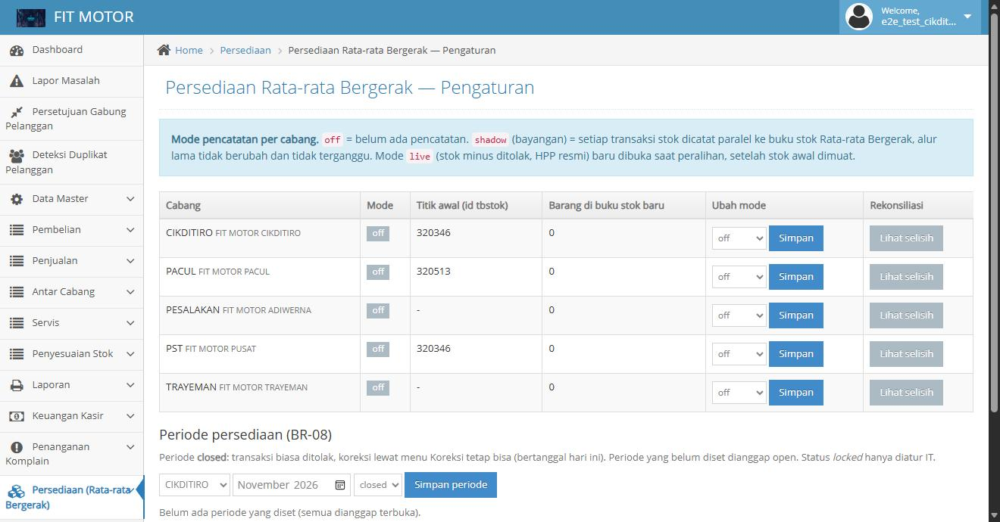

### Langkah 2. Cabang CIKDITIRO dinyalakan `live`
Status CIKDITIRO berubah menjadi `live`. Kolom "Barang di buku stok baru" menunjukkan 1. Cabang lain tetap `off`, jadi tidak terpengaruh.

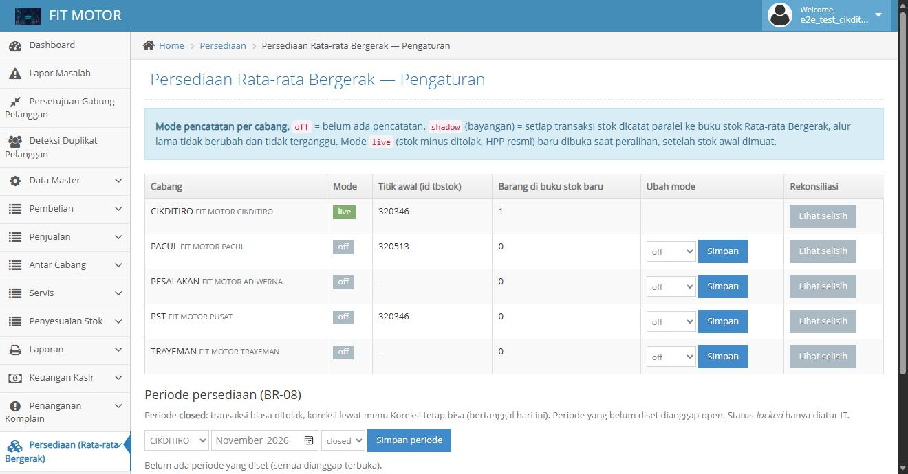

### Langkah 3. Halaman Stok Awal
Tempat memuat saldo awal dari opname fisik: unduh templat per lokasi, isi `qty_fisik`, unggah, validasi, baru muat. Pada demo ini stok awal 10 pcs @ Rp10.000 dimasukkan lewat skrip.

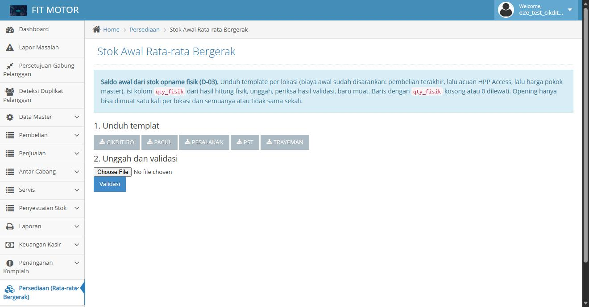

### Langkah 4. Kartu Stok Bernilai setelah stok awal, pembelian, dan penjualan
Ini gambar utama untuk presentasi. Urutan dari bawah ke atas:

| Kejadian | Masuk | Keluar | Biaya satuan | Rata-rata sesudah | Jumlah akhir | Nilai akhir |
|---|---|---|---|---|---|---|
| OPENING stok awal | 10 | | 10.000 | 10.000 | 10 | 100.000 |
| IN pembelian | 10 | | 14.000 | **12.000** | 20 | 240.000 |
| OUT penjualan | | 5 | 12.000 | 12.000 (tetap) | 15 | 180.000 |

Angka ini sama dengan contoh hitungan di bagian 3: rata-rata 12.000, HPP penjualan 5 × 12.000 = 60.000. Tabel "Riwayat perubahan rata-rata" di bawahnya mencatat kapan rata-rata berubah.

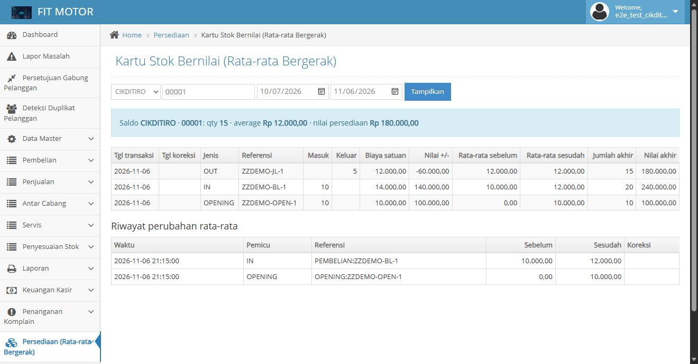

### Langkah 5. Valuasi Persediaan
Total nilai persediaan Rp180.000 untuk 15 pcs @ Rp12.000.

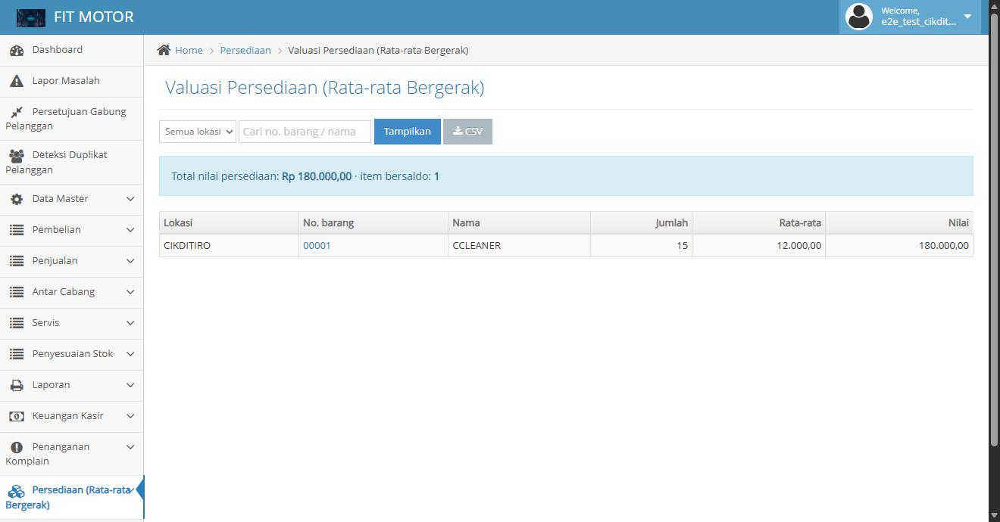

### Langkah 6. Stok tidak boleh minus
Percobaan menjual 100 pcs saat stok 14 pcs **ditolak** dan saldo tidak berubah. Pesan sistem: `Stok tidak cukup di CIKDITIRO untuk 00001. Tersedia: 14`. (Diuji lewat fungsi layanan, bukan lewat layar kasir. Uji layar kasir ada di hasil E2E sebelumnya.)

### Langkah 7. Mengajukan koreksi (barang rusak)
Halaman **Koreksi**. Pilih jenis "Barang hilang / rusak / dibuang". Setelah jenis dipilih, kolom Jenis pembuangan dan Berita acara muncul. Alasan wajib diisi.

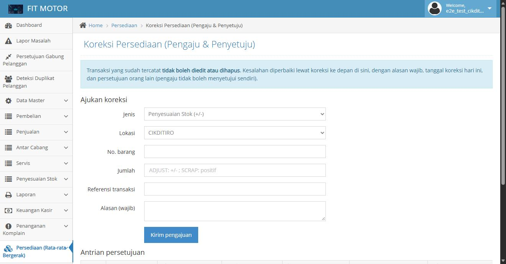
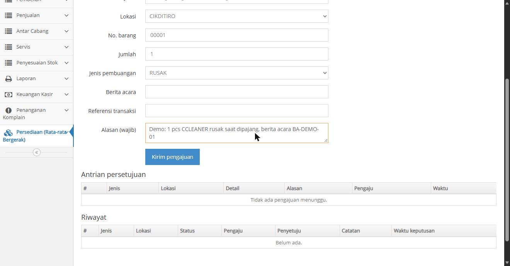

### Langkah 8. Pengajuan masuk antrian, stok belum berubah
Sistem menampilkan "Pengajuan #97 dikirim. Menunggu persetujuan orang lain." Pengajuan tampil di Antrian persetujuan beserta pengaju, alasan, dan waktu.

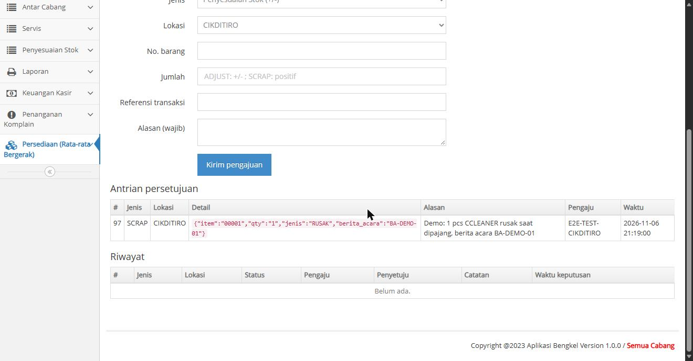

### Langkah 9. Penyetuju berbeda menyetujui
- Percobaan pengaju menyetujui pengajuannya sendiri **ditolak**: `Pengaju dan penyetuju tidak boleh orang yang sama`.
- Penyetuju lain (`KEU-DEMO`) menyetujui. Status menjadi `applied`, lengkap dengan catatan dan waktu keputusan.

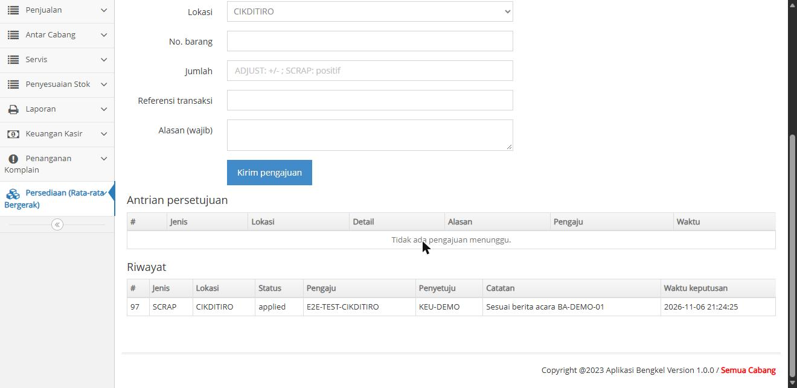

### Langkah 10. Hasil koreksi di Kartu Stok dan Valuasi
Baris baru `SCRAP_RUSAK` keluar 1 pcs pada rata-rata 12.000 (nilai −12.000), jumlah akhir 14, nilai akhir 168.000. Rata-rata tidak berubah. Valuasi ikut turun menjadi Rp168.000.

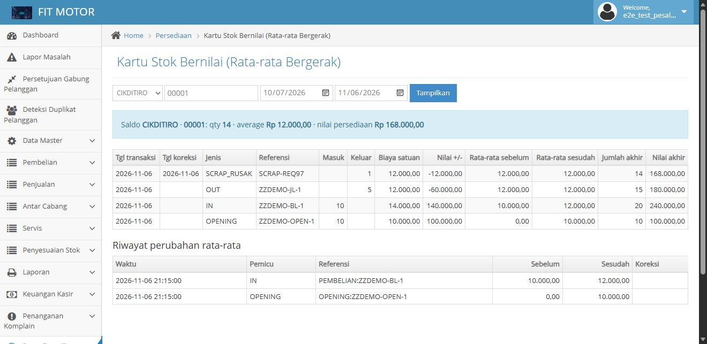
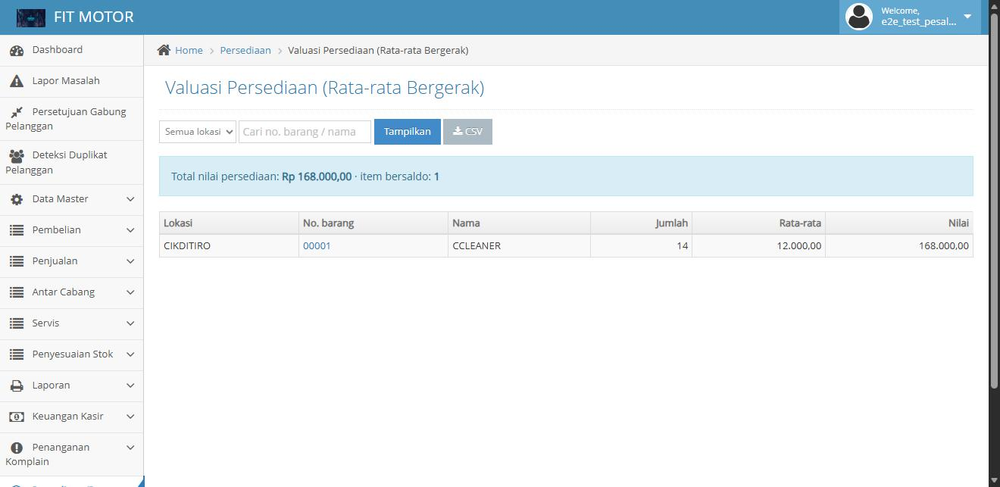

### Langkah 11. Laporan Transit, Selisih Harga, Klaim, HPP
Ringkasan di bagian atas: total persediaan Rp168.000, barang dalam perjalanan Rp0, selisih harga pembelian Rp0. Tabel "HPP periode 2026-11" untuk CIKDITIRO sumber PENJUALAN menunjukkan **Rp60.000**, sama dengan HPP penjualan 5 pcs.
Catatan: "piutang klaim supplier (pending) Rp1.000" berasal dari data uji lama di database lokal, bukan dari demo ini.

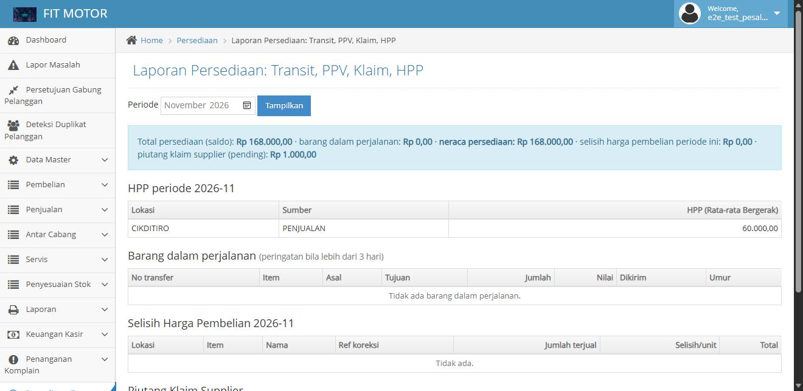

### Yang belum diambil gambarnya
- Layar kasir (POS), pembelian, dan servis bayar dalam kondisi `live`. Halaman ini sudah lulus uji klik penuh pada 1–2 November 2026, tetapi gambarnya belum diambil.
- Transfer antar cabang dengan status "dalam perjalanan" (laporan transit masih kosong di demo ini).

---

## 14. Pertanyaan yang mungkin muncul

**Kenapa transaksi tidak bisa dihapus atau diedit?**
Agar angka stok dan modal bisa diaudit. Kesalahan diperbaiki dengan koreksi yang tercatat dan disetujui orang kedua.

**Kenapa stok tidak boleh minus?**
Stok minus membuat rata-rata dan HPP tidak bermakna. Itu juga sumber utama data kacau di sistem lama.

**Apakah cabang saya langsung terpengaruh?**
Tidak. Semua cabang `off`. Pengaruh baru terasa saat cabang itu dinyalakan `live`.

**Bagaimana kalau ada masalah setelah `live`?**
Kembalikan mode ke `off`. Jalur lama tidak pernah dihapus. Untuk data yang sudah masuk ke buku besar, perbaikan dilakukan lewat koreksi atau oleh IT dengan backup.

**Apakah laba laporan lama berubah?**
Tidak. Data sebelum cutover tidak diubah. HPP baru hanya tersimpan untuk transaksi sesudah cabang `live`.

**Kenapa ada dua angka stok sementara?**
Laporan lama masih membaca `tbstok`. Cara menyatukannya (proyeksi `tbstok`) adalah keputusan yang masih terbuka.

---

## 15. Glosarium

| Istilah | Arti |
|---|---|
| HPP | Harga pokok penjualan, modal barang yang terjual |
| FIFO | First In First Out, modal dihitung dari batch terlama dulu |
| Moving Average | Modal dihitung dari rata-rata tertimbang, berubah saat ada barang masuk |
| Ledger | Buku besar, catatan mutasi stok bernilai (`inv_ledger`) |
| Shadow | Mode bayangan, mencatat di belakang layar tanpa mengubah alur lama |
| Live | Mode resmi, sistem baru berlaku |
| Opening stock | Saldo awal per barang dan lokasi dari opname fisik |
| Maker-checker | Satu orang mengajukan, orang lain menyetujui |
| PPV | Purchase Price Variance, selisih harga pembelian |
| COA | Chart of Accounts, daftar akun akuntansi |
| Rekonsiliasi | Mencocokkan dua sumber data, di sini ledger baru vs `tbstok` |
| Atomik | Semua langkah berhasil bersama, atau batal semuanya |
