# ERD — Entity Relationship Diagram FIT MOTOR (Web Bengkel)

> Digenerate otomatis dari skema database **live** `fitmotor_dbbengkel` (2026-09-25) + relasi yang dideklarasikan (`FOREIGN KEY`) dan relasi logis hasil analisis kode.

> Total **294 tabel aktif** (+ 8 tabel backup, 62 view) dibagi ke 14 domain. Diagram per domain supaya terbaca.

## Cara Membaca

- `PK` = primary key (atau *natural key* logis untuk tabel legacy yang tidak punya PRIMARY KEY di DB — ditandai `PK` juga, lihat catatan di LRS).
- `FK` = foreign key. **Hanya ~66 relasi yang benar-benar dideklarasikan di MySQL**; sisanya relasi *logis* (diterapkan lewat kode PHP, bukan constraint DB). Garis putus-putus tidak didukung Mermaid, jadi pembeda relasi *declared* vs *logis* ada di tabel relasi di [LRS.md](./LRS.md).
- Notasi: `||--o{` = satu ke banyak; `}o--||` = banyak ke satu; `||--||` = satu ke satu.
- Entitas dengan label `_ref` ditampilkan hanya PK-nya karena milik domain lain.

## Peta Antar-Domain (ringkas)

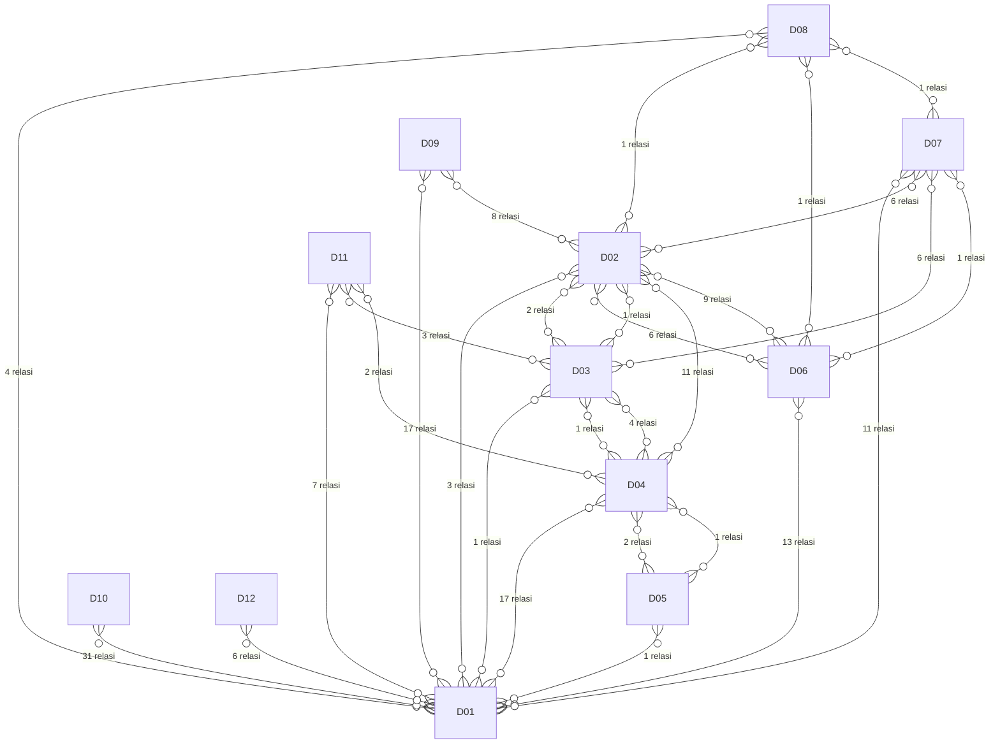

Kode domain: **D01** = Organisasi, User & Hak Akses; **D02** = Master Barang, Jasa & Paket; **D03** = Pelanggan, Kendaraan & CRM; **D04** = Servis, Antrian, Diagnosa & Garansi; **D05** = Promo & Diskon Periode; **D06** = Pembelian & Pengadaan (PR–RFQ–PO–DO–Invoice–Hutang); **D07** = Penjualan, Piutang & Retur; **D08** = Antar Cabang; **D09** = Stok & Inventory; **D10** = Keuangan Kasir & Setoran; **D11** = Komplain, Issue & Merge Data; **D12** = HRD & Absensi; **D13** = Integrasi & Konsolidasi Access; **D14** = Referensi & Lain-lain

---

## D01 — Organisasi, User & Hak Akses

29 tabel.

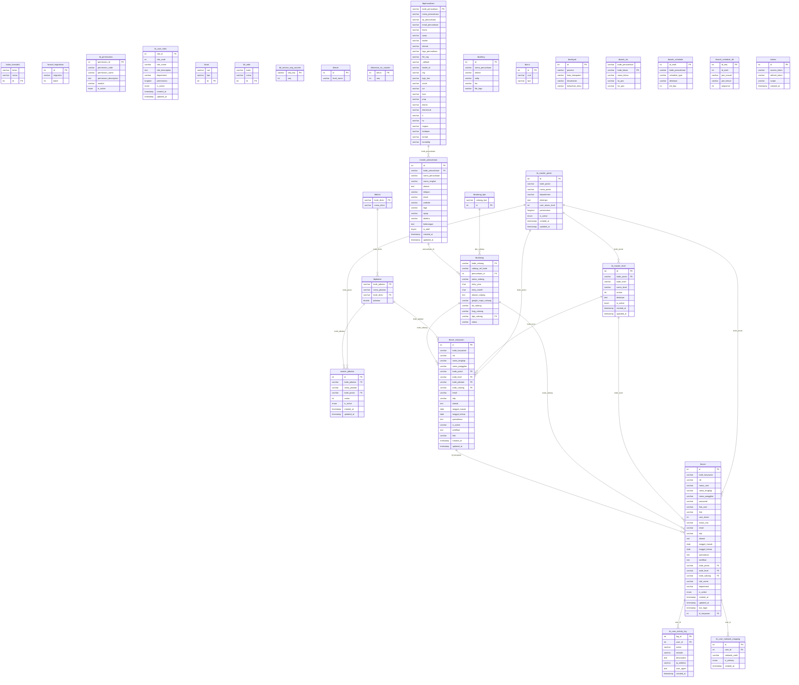

---

## D02 — Master Barang, Jasa & Paket

37 tabel.

```mermaid
erDiagram
    tbcara_bayar {
        int id PK
        varchar cara_bayar
    }
    tbharga_jual_rules {
        int id PK
        varchar jenis
        decimal margin
        int marginplus
        int bulat
        timestamp updated_at
    }
    tbhargajual {
        varchar jenis
        decimal margin
        double marginplus
        double bulat
        int id PK
        tinyint exclude_diskon_member
    }
    tbhjual_jasa {
        varchar jasa
        double nilai
        int id PK
    }
    tbitem_jenis_motor {
        int id PK
        varchar noitem FK
        int kd_kategori_motor FK
        int kd_jenis_motor
    }
    tbitem_validation_log {
        int id PK
        varchar noitem FK
        varchar status_lama
        varchar status_baru
        text keterangan
        int validated_by
        timestamp created_at
    }
    tbjenis_bayar {
        varchar jenis_bayar
    }
    tbkategori_rak {
        varchar kode PK
        varchar nama_kategori
        text deskripsi
        timestamp created_at
    }
    tblitem {
        varchar noitem PK
        varchar kodebarcode
        varchar namaitem
        varchar jenis FK
        varchar satuan FK
        double hargapokok
        double hargajual
        double hargajual2
        double hargajual3
        double hjqtyd2
        double hjqtyd3
        double hjqtys1
        double hjqtys2
        double totalpokok
        int quantity
        int stokmin
        varchar statusitem
        varchar supplier FK
        varchar supplier2 FK
        varchar supplier3 FK
        varchar statusproduk
        varchar gambar
        varchar note
        varchar rakbarang
        double jasawaktu
        varchar jasasatuanwaktu
        varchar jeniskomisi
        decimal komisiprosen
        double komisinominal
        int inv_idawal
        int inv_jmlawal
        double inv_hrgawal
        date inv_tglawal
        int stok_maks
        int kd_pabrik FK
        varchar kd_etalase
        int jenis_jasa
        enum tipe_item
        varchar merek
        varchar kode_part_resmi
        varchar nama_part_resmi
        varchar penggunaan_motor
        varchar merek_tipe
        varchar kategori_rak FK
        enum status_validasi
        int created_by
        int validated_by
        timestamp created_at
        timestamp updated_at
        tinyint exclude_diskon_member
    }
    tblitem_harga_cabang {
        varchar noitem PK,FK
        varchar kd_cabang PK,FK
        double hargapokok
        double hargajual
        double hargajual2
        double hargajual3
        int qty_access
        datetime tanggal_sync
    }
    tblitem_jasa {
        varchar noitem FK
        varchar namaitem
        int waktu
        double harga
    }
    tblitem_minmax {
        int id PK
        varchar no_item FK
        varchar kd_cabang FK
        decimal w1
        decimal w2
        decimal w3
        decimal w4
        decimal w5
        decimal w6
        decimal w7
        decimal w8
        decimal w9
        decimal w10
        decimal w11
        decimal w12
        decimal max_1w
        decimal max_2w
        decimal min_stok
        decimal max_stok
        decimal rop
        int total_transaksi_84hari
        decimal avg_interval_hari
        char kategori
        decimal stok_saat_ini
        int lead_time_hari
        varchar supplier1 FK
        varchar supplier2 FK
        tinyint min_max_manual
        date last_sale_date
        timestamp created_at
        timestamp updated_at
    }
    tblitem_spart {
        varchar noitem FK
        int kode_tipe
        int id PK
    }
    tblitem_stok {
        varchar noitem FK
        varchar kode_cabang FK
        int stokmin
        int stok_maks
        int stok_awal
        int rakbarang
    }
    tblitemjenis {
        varchar jenis
        varchar namajenis
        varchar _default
        int id PK
        bigint accurate_id
        varchar status
        decimal margin_khusus
        varchar ikut_margin_jenis
        varchar include_service
        text keterangan
    }
    tblitemsatuan {
        varchar satuan
        varchar namasatuan
        varchar _default
        int id PK
        varchar accurate_id
        text keterangan
        varchar status
    }
    tbljenis {
        varchar kodejenis PK
        varchar namajenis
        text keterangan
        enum statusjenis
    }
    tblnamabarang {
        int id PK
        varchar nama_barang
        varchar sinonim_1
        varchar sinonim_2
        varchar sinonim_3
        enum perlu_ukuran
        varchar keterangan
        varchar satuan
        enum status
    }
    tblsatuan {
        varchar kodesatuan PK
        varchar satuan
        text keterangan
        enum statussatuan
    }
    tbmaster_barang_custom {
        int id PK
        varchar kode_barang FK
        varchar nama_barang
        decimal harga_jual
        varchar satuan
        varchar kategori
        text deskripsi
        enum status_aktif
        varchar created_by
        timestamp created_at
        timestamp updated_at
    }
    tbmaster_barang_fastmoves {
        int id PK
        varchar kode_kategori FK
        varchar kode_barang FK
        tinyint is_featured
        int urutan
        timestamp created_at
    }
    tbmaster_barang_nonitem {
        int id PK
        varchar kode_barang_temp
        varchar nama_barang
        varchar kategori
        varchar satuan
        double harga_estimasi
        varchar supplier FK
        text keterangan
        enum status_approval
        tinyint perlu_approval
        varchar kode_barang_final
        varchar user_request
        varchar user_approval
        datetime tanggal_request
        datetime tanggal_approval
        text alasan_reject
        timestamp created_at
        timestamp updated_at
    }
    tbmaster_jenis_item {
        int id PK
        varchar kode
        varchar nama_jenis
        decimal margin
        varchar status
        timestamp created_at
        timestamp updated_at
    }
    tbmaster_kategori_fastmoves {
        int id PK
        varchar kode_kategori
        varchar nama_kategori
        varchar icon
        int urutan
        tinyint is_active
        timestamp created_at
    }
    tbmaster_kategori_item {
        int id PK
        varchar kategori_item
        text keterangan
        enum margin_sesuai_jenis
        decimal margin_kategori
        varchar status
        timestamp created_at
        timestamp updated_at
    }
    tbmaster_kategori_member {
        int id PK
        varchar status_member
        text benefit
        double min_nominal
        double max_nominal
        int urutan
        timestamp created_at
        int masa_garansi_hari
        int masa_garansi_maks_hari
    }
    tbmaster_nama_barang {
        int id PK
        varchar nama_barang
        varchar sinonim_1
        varchar sinonim_2
        varchar sinonim_3
        varchar ukuran
        varchar nama_utama
        text nama_alternatif
        varchar spesifikasi_diperlukan
        text keterangan
        varchar status
        timestamp created_at
        timestamp updated_at
    }
    tbpabrik_barang {
        int id PK
        varchar pabrik_barang
        varchar accurate_id
        text deskripsi
        tinyint accurate_synced
        varchar accurate_notes
        timestamp created_at
    }
    tbrakbarang {
        int id PK
        varchar rak_barang
    }
    tbstatus_harga {
        int id PK
        varchar status
    }
    tbstatus_produk {
        int id PK
        varchar status
    }
    tbtipe_item {
        int id PK
        varchar tipe
    }
    tbtipe_pajak {
        int id PK
        varchar tipe_pajak
    }
    tbtipe_potongan {
        varchar kdtipe
        varchar tipe_pot
    }
    tbworkorder_jenis_motor {
        int id PK
        varchar kode_wo FK
        int kd_kategori_motor FK
        int kd_jenis_motor
    }
    tbworkorderdetail {
        varchar kode_wo FK
        varchar kode_barang FK
        int jumlah
        varchar satuan
        int diskon
        varchar status_diskon
        int id PK
        varchar tipe
        double harga
        double total
        tinyint is_gratis
    }
    tbworkorderheader {
        varchar kode_wo PK
        varchar nama_wo
        varchar keterangan
        varchar status
        int waktu
        double harga
    }
    tbcabang {
        varchar cabang_ref_kode PK
        varchar kode_cabang PK
    }
    tbkategori_motor {
        int id PK
    }
    tblsupplier {
        varchar nosupplier PK
    }
    tbkategori_motor ||--o{ tbitem_jenis_motor : "kd_kategori_motor"
    tblitem ||--o{ tbitem_jenis_motor : "noitem"
    tblitem ||--o{ tbitem_validation_log : "noitem"
    tblitemjenis ||--o{ tblitem : "jenis"
    tbkategori_rak ||--o{ tblitem : "kategori_rak"
    tbpabrik_barang ||--o{ tblitem : "kd_pabrik"
    tblitemsatuan ||--o{ tblitem : "satuan"
    tblsupplier ||--o{ tblitem : "supplier"
    tblsupplier ||--o{ tblitem : "supplier2"
    tblsupplier ||--o{ tblitem : "supplier3"
    tbcabang ||--o{ tblitem_harga_cabang : "kd_cabang"
    tblitem ||--o{ tblitem_harga_cabang : "noitem"
    tblitem ||--o{ tblitem_jasa : "noitem"
    tbcabang ||--o{ tblitem_minmax : "kd_cabang"
    tblitem ||--o{ tblitem_minmax : "no_item"
    tblsupplier ||--o{ tblitem_minmax : "supplier1"
    tblsupplier ||--o{ tblitem_minmax : "supplier2"
    tblitem ||--o{ tblitem_spart : "noitem"
    tbcabang ||--o{ tblitem_stok : "kode_cabang"
    tblitem ||--o{ tblitem_stok : "noitem"
    tblitem ||--o{ tbmaster_barang_custom : "kode_barang"
    tblitem ||--o{ tbmaster_barang_fastmoves : "kode_barang"
    tbmaster_kategori_fastmoves ||--o{ tbmaster_barang_fastmoves : "kode_kategori"
    tblsupplier ||--o{ tbmaster_barang_nonitem : "supplier"
    tbkategori_motor ||--o{ tbworkorder_jenis_motor : "kd_kategori_motor"
    tbworkorderheader ||--o{ tbworkorder_jenis_motor : "kode_wo"
    tblitem ||--o{ tbworkorderdetail : "kode_barang"
    tbworkorderheader ||--o{ tbworkorderdetail : "kode_wo"
```

_Entitas eksternal (PK saja): `tbcabang` (D01), `tbkategori_motor` (D03), `tblsupplier` (D06)_

---

## D03 — Pelanggan, Kendaraan & CRM

30 tabel.

```mermaid
erDiagram
    customer_alias {
        varchar nopelanggan_lama PK
        varchar nopelanggan_baru FK
        timestamp created_at
    }
    customer_merge_log {
        int id PK
        varchar id_issue
        varchar nopelanggan_source FK
        varchar nopelanggan_target FK
        text alasan
        longtext snapshot_before_json
        int diajukan_oleh
        int disetujui_oleh
        enum status
        timestamp created_at
        timestamp executed_at
    }
    kendaraan_plat_history {
        bigint id PK
        bigint id_kendaraan FK
        varchar nopolisi FK
        date tanggal_mulai
        date tanggal_akhir
        tinyint is_current
        enum alasan
        int diinput_oleh
        timestamp created_at
    }
    kepemilikan_kendaraan {
        bigint id PK
        bigint id_kendaraan FK
        varchar nopelanggan FK
        date tanggal_mulai
        date tanggal_akhir
        tinyint is_current
        enum sumber
        int diinput_oleh
        timestamp created_at
    }
    master_kategori_member {
        int id_kategori PK
        varchar nama_kategori
        enum tipe_kategori
        decimal min_value
        decimal max_value
        int diskon_persen
        double diskon_jasa
        double diskon_barang
        text benefit_text
        varchar icon
        varchar warna
        int urutan
        tinyint is_active
        timestamp created_at
        timestamp updated_at
    }
    master_kedatangan_pelanggan {
        int id_kedatangan PK
        varchar no_pelanggan FK
        varchar no_service FK
        int kedatangan_ke
        date tanggal_datang
        date tanggal_sebelumnya
        int jarak_hari
        decimal total_transaksi
        int jumlah_item
        decimal rata2_nilai_per_item
        date estimasi_datang_berikut
        enum status_garansi
        text keterangan
        timestamp created_at
        timestamp updated_at
    }
    permintaan_pindah_kepemilikan_kendaraan {
        bigint id PK
        bigint id_kendaraan FK
        varchar nopelanggan_lama FK
        varchar nopelanggan_baru FK
        varchar nopolisi_snapshot
        date tanggal_efektif
        text alasan
        text catatan_internal
        enum status
        longtext blocker_snapshot_json
        int dibuat_oleh
        int disetujui_oleh
        int dieksekusi_oleh
        datetime approved_at
        datetime executed_at
        timestamp created_at
        timestamp updated_at
    }
    setting_highlight_member {
        int id PK
        varchar kategori_member
        varchar background_color
        varchar text_color
        varchar border_color
        int border_width
        tinyint is_bold
        decimal opacity
        tinyint is_active
        timestamp created_at
        timestamp updated_at
    }
    setting_kategori_member {
        int id PK
        varchar tipe_kategori
        tinyint is_enabled
        varchar keterangan
        timestamp created_at
    }
    statistik_kendaraan {
        bigint id_kendaraan PK,FK
        varchar nopelanggan_current FK
        int total_transaksi
        int total_kunjungan
        decimal total_nominal
        decimal total_jasa
        decimal total_sparepart
        int km_terakhir
        date tanggal_servis_terakhir
        timestamp updated_at
    }
    statistik_pelanggan {
        int id_statistik PK
        varchar no_pelanggan FK
        int total_transaksi
        decimal total_nominal
        int jumlah_kunjungan
        int kedatangan_terakhir
        decimal rata_jarak_kunjungan
        decimal rata_rata_transaksi
        varchar status_member
        double diskon_persen
        varchar kategori_member_kunjungan
        date tanggal_pertama_transaksi
        date tanggal_terakhir_transaksi
        int lama_tidak_datang
        int lama_menjadi_pelanggan
        date estimasi_datang_berikutnya
        int total_motor
        timestamp created_at
        timestamp updated_at
        int jumlah_cancel
        decimal cancel_rate
        date tanggal_cancel_terakhir
        int cancel_customer_request
        int cancel_no_stock
        int cancel_no_mekanik
        int cancel_no_show
        int cancel_lainnya
    }
    tb_booking {
        date tanggal
        varchar jam
        varchar nama
        varchar no_telepon
        varchar no_polisi FK
        varchar status_pelanggan
        int id PK
        varchar no_booking
        varchar status_booking
    }
    tbbagi_hasil {
        varchar stts PK
        varchar kategori PK
        int persen_bagihasil
        timestamp synced_at
    }
    tbinsentif_jual_servis {
        bigint id PK
        varchar siklus
        date tgl
        varchar trx
        decimal garap
        varchar stts
        varchar sts
        varchar kode
        varchar mekanik
        varchar tipe
        varchar no_item FK
        decimal quantity
        decimal jualnet
        decimal tothpp
        decimal laba
        varchar kategori
        datetime tanggal_data
        varchar kd_cabang FK
        timestamp created_at
    }
    tbjenis_motor {
        int kd PK
        varchar jenis
        text keterangan
        varchar status
    }
    tbkategori_motor {
        int id PK
        varchar kategori
        text keterangan
        varchar status
    }
    tbkomisijl_sales1 {
        int id PK
        varchar ket
    }
    tbkomisijl_sales2 {
        int id PK
        varchar ket
    }
    tblkendaraan {
        varchar nopolisi PK
        bigint id_kendaraan
        varchar pemilik
        varchar alamat
        int kode_merek FK
        varchar tipe
        int kode_tipe FK
        varchar jenis
        int kode_jenis FK
        varchar tahun_buat
        varchar tahun_rakit
        varchar silinder
        varchar warna
        int kode_warna FK
        varchar no_rangka
        varchar no_mesin
        varchar note
    }
    tblpelanggan {
        varchar nopelanggan PK
        varchar namapelanggan
        varchar alamat
        varchar kota
        varchar propinsi
        varchar kodepost
        varchar negara
        varchar telephone
        varchar no_wa
        varchar domisili_cabang
        varchar fax
        varchar kontakperson
        varchar note
        decimal potongan
        varchar tipepot
        varchar lavelharga
        varchar kgrup FK
        varchar patokan
        varchar foto_tampak_rumah
        text link_gmaps
        varchar notlp
        varchar klat
        varchar klong
        varchar panggilan
        double saldoawal
        date pertanggal
        date tgllahir
        int id_panggilan
        varchar bl_pajak
        varchar th_pajak
        int merek_id FK
        int tipe_id FK
        int jenis_id FK
        int warna_id FK
        varchar gender
        varchar valid_tgl_lahir
        varchar informasi_sumber
    }
    tblpelanggangrup {
        varchar kgrup PK
        varchar grup
        decimal diskon
    }
    tblsales {
        varchar nosales PK
        varchar namasales
        varchar alamat
        varchar kota
        varchar telephone
        decimal komisijual
        varchar _default
        double komisi_nominal
        varchar op_pil_hitung
        varchar op_pil_sistem_komisi
        varchar status_baris
    }
    tbmaster_tipe_detail {
        int id PK
        varchar kode_tipe
        varchar kode_brand
        int id_tipe_header FK
        varchar nama_detail
        int cc
        int id_jenis_motor
        varchar fitur_pembeda
        text ciri_fisik_pembeda
        int tahun_awal
        varchar tahun_akhir
        varchar no_seri_mesin
        int id_kategori_motor
        varchar status
        timestamp created_at
        timestamp updated_at
    }
    tbmaster_tipe_header {
        int id PK
        varchar nama_model
        int id_brand FK
        varchar status
        timestamp created_at
        timestamp updated_at
    }
    tbpabrik_motor {
        int id PK
        varchar merek
        varchar kode_brand
        varchar status
    }
    tbpanggilan {
        int id PK
        varchar panggilan
    }
    tbpersen_insentif {
        varchar posisi PK
        decimal persen_barang
        decimal persen_jasa
        timestamp synced_at
    }
    tbtipe_motor {
        int kode_tipe PK
        varchar tipe
        int kode_pabrik
        int kode_kategori
        varchar tahun
    }
    tbtipemotor {
        varchar tipe PK
        varchar pabrik
        varchar kategori
        timestamp synced_at
    }
    tbwarna {
        varchar warna
        int id PK
    }
    tbcabang {
        varchar cabang_ref_kode PK
        varchar kode_cabang PK
    }
    tblitem {
        varchar noitem PK
    }
    tblservice {
        varchar no_service PK
    }
    tblpelanggan ||--o{ customer_alias : "nopelanggan_baru"
    tblpelanggan ||--o{ customer_merge_log : "nopelanggan_source"
    tblpelanggan ||--o{ customer_merge_log : "nopelanggan_target"
    tblkendaraan ||--o{ kendaraan_plat_history : "id_kendaraan"
    tblkendaraan ||--o{ kendaraan_plat_history : "nopolisi"
    tblkendaraan ||--o{ kepemilikan_kendaraan : "id_kendaraan"
    tblpelanggan ||--o{ kepemilikan_kendaraan : "nopelanggan"
    tblpelanggan ||--o{ master_kedatangan_pelanggan : "no_pelanggan"
    tblservice ||--o{ master_kedatangan_pelanggan : "no_service"
    tblkendaraan ||--o{ permintaan_pindah_kepemilikan_kendaraan : "id_kendaraan"
    tblpelanggan ||--o{ permintaan_pindah_kepemilikan_kendaraan : "nopelanggan_baru"
    tblpelanggan ||--o{ permintaan_pindah_kepemilikan_kendaraan : "nopelanggan_lama"
    tblkendaraan ||--|| statistik_kendaraan : "id_kendaraan"
    tblpelanggan ||--o{ statistik_kendaraan : "nopelanggan_current"
    tblpelanggan ||--|| statistik_pelanggan : "no_pelanggan"
    tblkendaraan ||--o{ tb_booking : "no_polisi"
    tbcabang ||--o{ tbinsentif_jual_servis : "kd_cabang"
    tblitem ||--o{ tbinsentif_jual_servis : "no_item"
    tbjenis_motor ||--o{ tblkendaraan : "kode_jenis"
    tbpabrik_motor ||--o{ tblkendaraan : "kode_merek"
    tbtipe_motor ||--o{ tblkendaraan : "kode_tipe"
    tbwarna ||--o{ tblkendaraan : "kode_warna"
    tbjenis_motor ||--o{ tblpelanggan : "jenis_id"
    tblpelanggangrup ||--o{ tblpelanggan : "kgrup"
    tbpabrik_motor ||--o{ tblpelanggan : "merek_id"
    tbtipe_motor ||--o{ tblpelanggan : "tipe_id"
    tbwarna ||--o{ tblpelanggan : "warna_id"
    tbmaster_tipe_header ||--o{ tbmaster_tipe_detail : "id_tipe_header"
    tbpabrik_motor ||--o{ tbmaster_tipe_header : "id_brand"
```

_Entitas eksternal (PK saja): `tbcabang` (D01), `tblitem` (D02), `tblservice` (D04)_

---

## D04 — Servis, Antrian, Diagnosa & Garansi

40 tabel.

```mermaid
erDiagram
    log_perubahan_tarif {
        int id PK
        timestamp tanggal
        int user_id
        enum aksi
        int tarif_id
        text data_lama
        text data_baru
        text keterangan
    }
    master_tarif_jemput_range {
        int id PK
        enum jenis_motor
        decimal jarak_min
        decimal jarak_max
        int tarif_dasar
        int tarif_per_km
        text keterangan
        tinyint aktif
        timestamp created_at
        timestamp updated_at
    }
    servis_komisi {
        int id PK
        varchar no_service FK
        varchar kd_cabang FK
        enum peran
        double nominal_jasa
        double nominal_barang
        int persen_terpakai
        enum dihitung_saat
        varchar id_issue_ref
        timestamp created_at
    }
    tb_antrian_servis {
        int id PK
        varchar no_antrian
        varchar no_service FK
        date tanggal
        time jam_ambil
        time jam_mulai
        time jam_selesai
        enum status_antrian
        enum prioritas
        int estimasi_waktu
        text catatan
        timestamp created_at
        timestamp updated_at
        text alasan_batal
        varchar user_batal
        datetime waktu_batal
    }
    tb_approval_diskon {
        int id PK
        varchar no_service FK
        enum jenis
        decimal nominal_diskon
        decimal persen_diskon
        text alasan
        enum status
        varchar id_user_cs
        varchar id_user_supervisor
        datetime tanggal_request
        datetime tanggal_approval
        varchar kd_cabang FK
    }
    tb_dp_servis {
        int id PK
        varchar no_service FK
        varchar no_dp
        date tanggal_dp
        decimal jumlah_dp
        enum status
        datetime tanggal_offset
        text keterangan
        varchar id_user
        varchar kd_cabang FK
        timestamp created_at
    }
    tb_kepala_mekanik_schedule {
        int id PK
        varchar kode_karyawan FK
        varchar kode_cabang FK
        date tanggal_kerja
        enum shift
        enum status_kehadiran
        timestamp created_at
    }
    tb_log_antrian {
        int id PK
        varchar no_antrian FK
        varchar no_service FK
        varchar aktivitas
        text keterangan
        varchar user_id
        varchar user_nama
        timestamp created_at
    }
    tb_log_cancel_servis {
        int id PK
        varchar no_service FK
        datetime tanggal_cancel
        text alasan_cancel
        enum kategori_alasan
        varchar user_cancel
        double biaya_cancel
        enum status_barang
        enum status_pembayaran
        double nominal_dp
        double nominal_refund
        text catatan
        timestamp created_at
    }
    tb_master_garansi {
        int id PK
        varchar kategori_member
        varchar jenis_servis
        int masa_garansi_hari
        int masa_garansi_maks
        text keterangan
        tinyint aktif
        datetime created_at
        datetime updated_at
    }
    tb_mekanik_progress {
        int id PK
        varchar no_service FK
        varchar kode_karyawan FK
        enum status_progress
        datetime waktu_mulai
        datetime waktu_selesai
        text catatan
        timestamp created_at
    }
    tb_progress_mekanik {
        int id PK
        varchar no_service FK
        varchar no_antrian FK
        varchar mekanik_id
        varchar nama_mekanik
        enum jenis_mekanik
        int persen_kerja
        enum status_kerja
        time jam_mulai
        time jam_selesai
        text catatan_kerja
        timestamp created_at
        timestamp updated_at
    }
    tbkeluhan_proses {
        int id PK
        varchar kode_keluhan FK
        varchar kode_item FK
        enum tipe_proses
        varchar nama_proses
        text deskripsi
        int estimasi_waktu
        double harga_estimasi
        varchar wajib
        int urutan
        varchar status_aktif
        timestamp created_at
    }
    tbl_kepala_mekanik_harian {
        int id PK
        varchar kode_cabang FK
        date tanggal_kerja
        varchar kepala_mekanik_1
        varchar kepala_mekanik_2
        enum shift_kerja
        text keterangan
        int created_by
        timestamp created_at
        timestamp updated_at
    }
    tblkeluhan {
        int id_keluhan PK
        varchar kode_keluhan FK
        varchar nama_keluhan
        text deskripsi
        int estimasi_waktu
        enum status
    }
    tblretur_servis_detail {
        varchar no_retur FK
        varchar no_service FK
        enum tipe_item
        varchar no_item FK
        int quantity
        double harga
        double total
        varchar alasan_retur
        varchar user
        varchar kd_cabang FK
        int id PK
    }
    tblretur_servis_header {
        varchar noretur PK
        varchar no_service FK
        varchar tanggal
        varchar note
        varchar cara_bayar_refund
        int total_qty_retur
        double total_retur
        varchar user
        varchar kd_cabang PK,FK
        varchar status_retur
        varchar status_refund
        datetime tanggal_refund
    }
    tblservice {
        varchar no_service PK
        date tanggal
        varchar jam
        varchar no_pelanggan FK
        varchar no_polisi FK
        varchar status
        varchar kd_cabang PK,FK
        int id_user FK
        double total
        int diskon_persen
        double diskon_nom
        int ppn_persen
        double ppn_nom
        double total_grand
        double bayar
        double kembali
        int jenis_bayar
        int total_waktu
        varchar status_jemput
        enum kondisi_motor
        decimal jarak_jemput
        int tarif_jemput
        varchar keterangan
        varchar foto_motor
        int km_skr
        varchar mekanik1 FK
        varchar mekanik2
        varchar mekanik3
        varchar mekanik4
        double biayaM1
        double biayaM2
        double biayaM3
        double biayaM4
        int km_berikut
        double subtotal_jasa
        double subtotal_item
        double subtotal
        double total_diskon
        double total_pajak
        double total_akhir
        timestamp created_at
        timestamp updated_at
        enum status_servis
        tinyint boleh_dp
        text keterangan_jemput
        varchar foto_patokan
        varchar kepala_mekanik1 FK
        varchar kepala_mekanik2
        varchar admin1
        varchar admin2
        int persen_kepala_mekanik1
        int persen_kepala_mekanik2
        int persen_admin1
        int persen_admin2
        int persen_mekanik1
        int persen_mekanik2
        int persen_mekanik3
        int persen_mekanik4
        varchar metode_pembayaran
        varchar bukti_pembayaran
        datetime tanggal_cancel
        text alasan_cancel
        varchar user_cancel
        double biaya_cancel
        text cancel_note
        double total_penawaran
        double total_penawaran_disetujui
        int jumlah_temuan
        int jumlah_penawaran
        decimal bayar_tunai
        decimal bayar_transfer
        decimal bayar_qris
        varchar ref_transfer
        varchar bukti_transfer
        tinyint is_garansi
        varchar ref_no_service_original FK
        date tanggal_garansi_expire
        varchar mekanik_original
        enum komisi_garansi_mode
        decimal total_retur
        varchar ref_no_penjualan_asal
    }
    tblservice_advisor {
        varchar no_service PK,FK
        varchar kd_cabang PK,FK
        varchar advisor
    }
    tblservice_jemputantar {
        varchar no_service PK,FK
        varchar kd_cabang PK,FK
        date tanggal
        varchar no_pelanggan FK
        varchar no_polisi FK
        time jam
        varchar keterangan
        timestamp synced_at
    }
    tblservis_barang {
        varchar no_service FK
        varchar kd_cabang FK
        int nobaris
        varchar no_item FK
        int quantity
        int qty_retur
        double harga_jual
        double potongan
        double total
        varchar diskon_source
        double diskon_persen
        double diskon_nominal
        int id_promo FK
        timestamp created_at
        timestamp updated_at
        int id PK
        text keterangan
        enum asal_barang
    }
    tblservis_jasa {
        varchar no_service FK
        varchar kd_cabang FK
        int nobaris
        varchar no_item FK
        int waktu
        double harga
        double potongan
        double total
        varchar diskon_source
        double diskon_persen
        double diskon_nominal
        int id_promo FK
        timestamp created_at
        timestamp updated_at
        int id PK
        int qty_retur
    }
    tbmaster_keluhan {
        int id PK
        varchar kode_keluhan
        varchar nama_keluhan
        text deskripsi
        varchar kategori
        varchar status_aktif
        enum status_approval
        varchar requested_by
        varchar requested_from
        varchar approved_by
        datetime approved_at
        text rejection_reason
        timestamp created_at
        timestamp updated_at
        varchar estimasi_waktu
        varchar tingkat_prioritas
        varchar workorder_default FK
    }
    tbmaster_keluhan_temuan {
        int id PK
        varchar kode_keluhan FK
        varchar kode_temuan FK
        int prioritas
        tinyint is_mandatory
        timestamp created_at
    }
    tbmaster_keluhan_workorder {
        int id PK
        varchar kode_keluhan FK
        varchar kode_workorder FK
        enum prioritas
        varchar status_aktif
        timestamp created_at
        timestamp updated_at
    }
    tbmaster_temuan {
        int id PK
        varchar kode_temuan
        varchar nama_temuan
        text deskripsi
        varchar kategori
        enum tingkat_urgensi
        tinyint is_active
        timestamp created_at
        timestamp updated_at
    }
    tbmaster_temuan_barang_mapping {
        int id PK
        varchar kode_temuan FK
        varchar noitem FK
        tinyint is_primary
        int prioritas
        int qty_default
        varchar keterangan
        tinyint status_aktif
        varchar created_by
        timestamp created_at
        varchar updated_by
        timestamp updated_at
    }
    tbmekanik_level {
        int id PK
        varchar mekanik_level
    }
    tbservis_keluhan {
        varchar no_service FK
        varchar keluhan
        int id PK
    }
    tbservis_keluhan_status {
        int id PK
        varchar no_service FK
        varchar keluhan
        varchar kategori
        varchar kode_keluhan FK
        enum status_pengerjaan
        varchar auto_workorder
        tinyint workorder_applied
        varchar keterangan_tidak_selesai
        timestamp created_at
        timestamp updated_at
    }
    tbservis_keluhan_tracking {
        int id PK
        varchar no_service FK
        int keluhan_id FK
        int proses_id FK
        enum status_proses
        varchar mekanik_id
        datetime waktu_mulai
        datetime waktu_selesai
        text catatan
        double biaya_actual
        timestamp created_at
        timestamp updated_at
    }
    tbservis_penawaran_jasa {
        int id PK
        varchar no_service FK
        int temuan_id FK
        varchar kode_jasa
        varchar nama_jasa
        double harga
        int waktu_estimasi
        tinyint is_from_suggestion
        int mapping_id
        enum status_penawaran
        varchar alasan_tolak
        text keterangan_tolak
        varchar user_penawaran
        varchar user_respon
        datetime tanggal_respon
        text catatan_penawaran
        timestamp created_at
        timestamp updated_at
    }
    tbservis_penawaran_log {
        int id PK
        int penawaran_id FK
        varchar no_service FK
        enum action
        text alasan
        varchar user_action
        timestamp created_at
    }
    tbservis_penawaran_part {
        int id PK
        varchar no_service FK
        int temuan_id FK
        tinyint is_from_suggestion
        int suggestion_priority
        varchar kode_barang FK
        varchar nama_barang
        int quantity
        double harga_satuan
        double total_harga
        int stok_tersedia
        varchar estimasi_ketersediaan
        enum status_penawaran
        enum alasan_tolak
        text keterangan_tolak
        text catatan_penawaran
        decimal discount_persen
        decimal discount_nominal
        decimal harga_final
        datetime tanggal_penawaran
        datetime tanggal_respon
        varchar user_penawaran
        varchar user_respon
        timestamp created_at
        timestamp updated_at
    }
    tbservis_penawaran_rejection_summary {
        int id PK
        varchar kode_barang FK
        varchar nama_barang
        int total_penawaran
        int total_diterima
        int total_ditolak
        varchar alasan_tolak_terbanyak
        decimal acceptance_rate
        date last_offered_date
        timestamp updated_at
    }
    tbservis_pending_items {
        int id PK
        varchar no_service FK
        int wo_id FK
        varchar kode_item FK
        varchar nama_item
        enum tipe
        int quantity
        decimal harga_satuan
        decimal total
        int waktu
        enum status_approval
        enum alasan_tolak
        text keterangan_tolak
        varchar approved_by
        timestamp approved_at
        timestamp created_at
        timestamp updated_at
        tinyint is_gratis
    }
    tbservis_pengerjaan {
        varchar no_service FK
        varchar item_pengerjaan
        varchar kd_mekanik
        varchar status_pengerjaan
        int id PK
    }
    tbservis_temuan {
        int id PK
        varchar no_service FK
        int keluhan_id FK
        varchar mekanik_id
        varchar mekanik_name
        varchar kode_temuan FK
        varchar temuan_custom
        text deskripsi_temuan
        enum jenis_perbaikan
        enum status_temuan
        text keterangan_tidak_selesai
        enum tingkat_urgensi
        double estimasi_biaya
        double biaya_actual
        varchar foto_temuan
        varchar created_by
        timestamp created_at
        varchar updated_by
        timestamp updated_at
    }
    tbservis_temuan_activity_log {
        int id PK
        varchar no_service FK
        int temuan_id FK
        int penawaran_id
        enum activity_type
        text description
        text old_value
        text new_value
        varchar user_id
        varchar user_name
        varchar ip_address
        varchar user_agent
        timestamp created_at
    }
    tbservis_workorder {
        int id PK
        varchar no_service FK
        varchar kode_wo FK
        enum status_pengerjaan
        varchar keterangan_tidak_selesai
        timestamp created_at
        timestamp updated_at
    }
    master_diskon_periode {
        int id_promo PK
    }
    tbcabang {
        varchar cabang_ref_kode PK
        varchar kode_cabang PK
    }
    tblitem {
        varchar noitem PK
    }
    tblkendaraan {
        bigint id_kendaraan PK
        varchar nopolisi PK
    }
    tblpelanggan {
        varchar nopelanggan PK
    }
    tbuser {
        int id PK
        varchar kode_karyawan PK
    }
    tbuser_karyawan {
        int id PK
        varchar kode_karyawan PK
    }
    tbworkorderheader {
        varchar kode_wo PK
    }
    tbcabang ||--o{ servis_komisi : "kd_cabang"
    tblservice ||--o{ servis_komisi : "no_service"
    tblservice ||--o{ tb_antrian_servis : "no_service"
    tbcabang ||--o{ tb_approval_diskon : "kd_cabang"
    tblservice ||--o{ tb_approval_diskon : "no_service"
    tbcabang ||--o{ tb_dp_servis : "kd_cabang"
    tblservice ||--o{ tb_dp_servis : "no_service"
    tbcabang ||--o{ tb_kepala_mekanik_schedule : "kode_cabang"
    tbuser_karyawan ||--o{ tb_kepala_mekanik_schedule : "kode_karyawan"
    tb_antrian_servis ||--o{ tb_log_antrian : "no_antrian"
    tblservice ||--o{ tb_log_antrian : "no_service"
    tblservice ||--o{ tb_log_cancel_servis : "no_service"
    tbuser_karyawan ||--o{ tb_mekanik_progress : "kode_karyawan"
    tblservice ||--o{ tb_mekanik_progress : "no_service"
    tb_antrian_servis ||--o{ tb_progress_mekanik : "no_antrian"
    tblservice ||--o{ tb_progress_mekanik : "no_service"
    tblitem ||--o{ tbkeluhan_proses : "kode_item"
    tbmaster_keluhan ||--o{ tbkeluhan_proses : "kode_keluhan"
    tbcabang ||--o{ tbl_kepala_mekanik_harian : "kode_cabang"
    tbmaster_keluhan ||--o{ tblkeluhan : "kode_keluhan"
    tbcabang ||--o{ tblretur_servis_detail : "kd_cabang"
    tblitem ||--o{ tblretur_servis_detail : "no_item"
    tblretur_servis_header ||--o{ tblretur_servis_detail : "no_retur"
    tblservice ||--o{ tblretur_servis_detail : "no_service"
    tbcabang ||--o{ tblretur_servis_header : "kd_cabang"
    tblservice ||--o{ tblretur_servis_header : "no_service"
    tbuser ||--o{ tblservice : "id_user"
    tbcabang ||--o{ tblservice : "kd_cabang"
    tbuser ||--o{ tblservice : "kepala_mekanik1"
    tbuser ||--o{ tblservice : "mekanik1"
    tblpelanggan ||--o{ tblservice : "no_pelanggan"
    tblkendaraan ||--o{ tblservice : "no_polisi"
    tblservice ||--o{ tblservice : "ref_no_service_original"
    tbcabang ||--o{ tblservice_advisor : "kd_cabang"
    tblservice ||--o{ tblservice_advisor : "no_service"
    tbcabang ||--o{ tblservice_jemputantar : "kd_cabang"
    tblpelanggan ||--o{ tblservice_jemputantar : "no_pelanggan"
    tblkendaraan ||--o{ tblservice_jemputantar : "no_polisi"
    tblservice ||--o{ tblservice_jemputantar : "no_service"
    master_diskon_periode ||--o{ tblservis_barang : "id_promo"
    tbcabang ||--o{ tblservis_barang : "kd_cabang"
    tblitem ||--o{ tblservis_barang : "no_item"
    tblservice ||--o{ tblservis_barang : "no_service"
    master_diskon_periode ||--o{ tblservis_jasa : "id_promo"
    tbcabang ||--o{ tblservis_jasa : "kd_cabang"
    tblitem ||--o{ tblservis_jasa : "no_item"
    tblservice ||--o{ tblservis_jasa : "no_service"
    tbworkorderheader ||--o{ tbmaster_keluhan : "workorder_default"
    tbmaster_keluhan ||--o{ tbmaster_keluhan_temuan : "kode_keluhan"
    tbmaster_temuan ||--o{ tbmaster_keluhan_temuan : "kode_temuan"
    tbmaster_keluhan ||--o{ tbmaster_keluhan_workorder : "kode_keluhan"
    tbworkorderheader ||--o{ tbmaster_keluhan_workorder : "kode_workorder"
    tbmaster_temuan ||--o{ tbmaster_temuan_barang_mapping : "kode_temuan"
    tblitem ||--o{ tbmaster_temuan_barang_mapping : "noitem"
    tblservice ||--o{ tbservis_keluhan : "no_service"
    tbmaster_keluhan ||--o{ tbservis_keluhan_status : "kode_keluhan"
    tblservice ||--o{ tbservis_keluhan_status : "no_service"
    tbservis_keluhan_status ||--o{ tbservis_keluhan_tracking : "keluhan_id"
    tblservice ||--o{ tbservis_keluhan_tracking : "no_service"
    tbkeluhan_proses ||--o{ tbservis_keluhan_tracking : "proses_id"
    tblservice ||--o{ tbservis_penawaran_jasa : "no_service"
    tbservis_temuan ||--o{ tbservis_penawaran_jasa : "temuan_id"
    tblservice ||--o{ tbservis_penawaran_log : "no_service"
    tbservis_penawaran_part ||--o{ tbservis_penawaran_log : "penawaran_id"
    tblitem ||--o{ tbservis_penawaran_part : "kode_barang"
    tblservice ||--o{ tbservis_penawaran_part : "no_service"
    tbservis_temuan ||--o{ tbservis_penawaran_part : "temuan_id"
    tblitem ||--o{ tbservis_penawaran_rejection_summary : "kode_barang"
    tblitem ||--o{ tbservis_pending_items : "kode_item"
    tblservice ||--o{ tbservis_pending_items : "no_service"
    tbservis_workorder ||--o{ tbservis_pending_items : "wo_id"
    tblservice ||--o{ tbservis_pengerjaan : "no_service"
    tbservis_keluhan_status ||--o{ tbservis_temuan : "keluhan_id"
    tbmaster_temuan ||--o{ tbservis_temuan : "kode_temuan"
    tblservice ||--o{ tbservis_temuan : "no_service"
    tblservice ||--o{ tbservis_temuan_activity_log : "no_service"
    tbservis_temuan ||--o{ tbservis_temuan_activity_log : "temuan_id"
    tbworkorderheader ||--o{ tbservis_workorder : "kode_wo"
    tblservice ||--o{ tbservis_workorder : "no_service"
```

_Entitas eksternal (PK saja): `master_diskon_periode` (D05), `tbcabang` (D01), `tblitem` (D02), `tblkendaraan` (D03), `tblpelanggan` (D03), `tbuser` (D01), `tbuser_karyawan` (D01), `tbworkorderheader` (D02)_

---

## D05 — Promo & Diskon Periode

5 tabel.

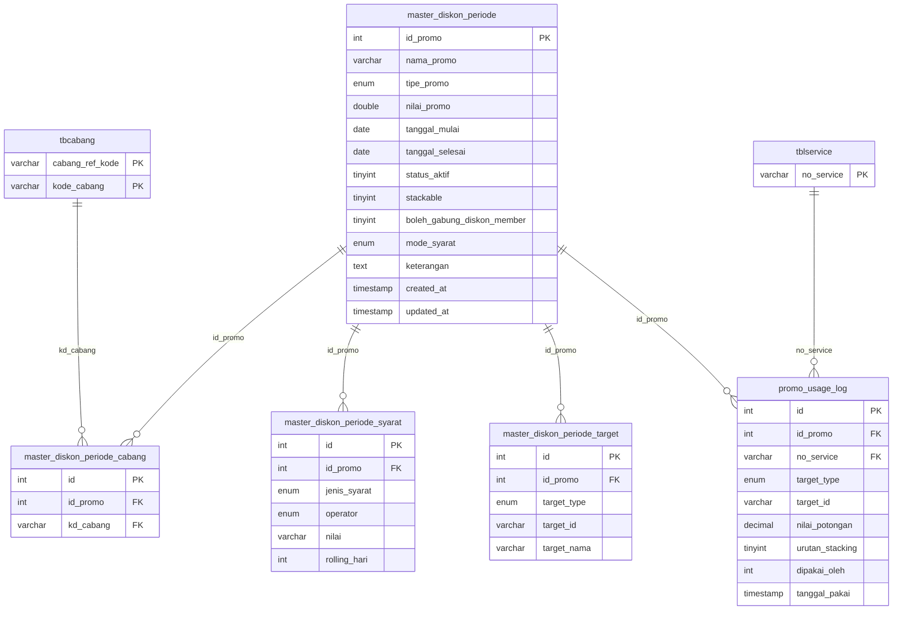

_Entitas eksternal (PK saja): `tbcabang` (D01), `tblservice` (D04)_

---

## D06 — Pembelian & Pengadaan (PR–RFQ–PO–DO–Invoice–Hutang)

26 tabel.

```mermaid
erDiagram
    alarm_harga_beli {
        int id PK
        varchar no_item FK
        varchar no_transaksi_pembelian FK
        double harga_beli_lama
        double harga_beli_baru
        double persen_selisih
        enum arah
        double threshold_saat_itu
        double harga_jual_saat_ini
        varchar status_klasifikasi
        enum status_review
        varchar direview_oleh
        timestamp created_at
    }
    tb_master_approval_pembelian {
        int id PK
        int level_approval
        varchar nama_level
        decimal batas_bawah
        decimal batas_atas
        varchar kode_posisi FK
        int urutan
        tinyint aktif
        timestamp created_at
        timestamp updated_at
    }
    tb_master_threshold_harga {
        int id PK
        enum arah
        double persen_threshold
        tinyint aktif
        varchar updated_by
        timestamp updated_at
    }
    tbbeli_peritem_history {
        bigint id PK
        varchar id_tabel
        date tanggal
        varchar no_item FK
        decimal hrgnet
        varchar no_supplier FK
        varchar fax
        varchar kd_cabang FK
        timestamp created_at
    }
    tbldelivery_order_detail {
        int id PK
        varchar no_do FK
        int nobaris
        varchar no_item FK
        int qty_po
        int qty_kirim
        int qty_terima
        int qty_reject
        text keterangan
    }
    tbldelivery_order_header {
        varchar no_do PK
        varchar no_po FK
        varchar no_supplier FK
        date tanggal_do
        date tanggal_kirim
        date tanggal_estimasi_tiba
        date tanggal_tiba
        varchar no_surat_jalan
        varchar no_kendaraan
        varchar nama_pengirim
        varchar telp_pengirim
        text alamat_kirim
        int total_qty
        enum status_do
        text keterangan
        varchar kd_cabang FK
        varchar created_by
        timestamp created_at
        timestamp updated_at
    }
    tbldo_tracking {
        int id PK
        varchar no_do FK
        varchar status
        text keterangan
        varchar lokasi
        varchar updated_by
        timestamp updated_at
    }
    tblhutang_detail {
        varchar no_transaksi PK,FK
        int nobaris PK
        varchar no_pembelian FK
        varchar keterangan
        double jumlah_hutang
        double jumlah_bayar
        varchar status
    }
    tblhutang_header {
        varchar no_transaksi PK
        varchar tanggal
        varchar no_supplier FK
        varchar note
        double total_bayar
        varchar user
        varchar id_tabel
        varchar kd_cabang PK,FK
    }
    tblorder_detail {
        varchar no_order FK
        int nobaris
        varchar no_item FK
        int quantity
        int qty_terima
        double harga_pokok
        double total
        varchar user
        varchar status_trx
        varchar kd_cabang FK
        int id PK
    }
    tblorder_header {
        varchar no_order PK
        varchar status
        varchar tanggal
        varchar tglkirim
        varchar no_supplier FK
        varchar note
        int total_qty
        double total_terima
        double total_order
        varchar user
        varchar Id_tabel
        varchar kd_cabang FK
        varchar status_pesanan
        varchar tipe_trx
        varchar no_penjualan
        varchar no_pr FK
        varchar no_rfq FK
        enum status_approval
        varchar approved_by
        datetime approved_date
        varchar rejected_by
        datetime rejected_date
        mediumtext reject_reason
        enum po_type
        varchar payment_term
        mediumtext delivery_address
        varchar contact_person
        varchar contact_phone
    }
    tblpembelian_detail {
        varchar no_transaksi FK
        int nobaris
        varchar no_item FK
        int qty_order
        int quantity
        int qty_retur
        double harga_pokok
        double potongan
        double harga_sp
        double total
        varchar sts_order
        varchar id_inv
        int id PK
        varchar user
        varchar kd_cabang FK
        varchar status_trx
    }
    tblpembelian_header {
        varchar notransaksi PK
        varchar status
        varchar carabayar
        varchar tanggal
        varchar no_order FK
        varchar tanggal_order
        varchar no_supplier FK
        varchar note
        int total_qty_order
        int total_qty
        double total_beli
        decimal diskon
        double total_diskon
        decimal pajak
        double total_pajak
        double total_akhir
        double total_retur
        double pembayaran
        varchar tanggal_jt
        varchar tanggal_lunas
        int jumlah_bayar
        varchar user
        varchar Id_tabel
        varchar kd_cabang PK,FK
        varchar status_lunas
        int lama_hari
        varchar no_do FK
        varchar no_pr FK
        enum status_qc
        varchar qc_by
        datetime qc_date
        text qc_notes
    }
    tblpo_approval_log {
        int id PK
        varchar no_po FK
        int level_approval
        varchar approver
        enum action
        text notes
        timestamp action_date
    }
    tblpr_approval_log {
        int id PK
        varchar no_pr FK
        int level_approval
        varchar approver
        enum action
        text notes
        timestamp action_date
    }
    tblpr_tracking {
        int id PK
        varchar no_pr FK
        varchar status_old
        varchar status_new
        text keterangan
        varchar updated_by
        timestamp updated_at
    }
    tblpurchase_request_detail {
        int id PK
        varchar no_pr FK
        int nobaris
        varchar no_item FK
        varchar nama_item
        int quantity
        int qty_approved
        int qty_po
        varchar satuan
        decimal harga_estimasi
        decimal total_estimasi
        text keterangan
        enum status_item
    }
    tblpurchase_request_header {
        varchar no_pr PK
        date tanggal_pr
        date tanggal_butuh
        varchar requester
        varchar departemen
        text alasan
        int total_qty
        decimal total_estimasi
        enum status_pr
        varchar approved_by
        datetime approved_date
        varchar rejected_by
        datetime rejected_date
        text reject_reason
        varchar kd_cabang FK
        varchar created_by
        timestamp created_at
        timestamp updated_at
    }
    tblretur_pembelian_detail {
        varchar no_retur FK
        varchar no_pembelian
        varchar no_item FK
        int quantity
        double harga_pokok
        double potongan
        double total
        varchar user
        varchar kd_cabang FK
        varchar alasan_retur
        int jenis_penggantian
        int id PK
        varchar status_penggantian
    }
    tblretur_pembelian_header {
        varchar noretur PK
        varchar nopembelian FK
        varchar tanggal
        varchar note
        int total_qty_retur
        double total_retur
        decimal diskon
        double total_diskon
        decimal pajak
        double total_pajak
        double total_akhir
        varchar user
        varchar kd_cabang PK,FK
        varchar status_retur
    }
    tblrfq_detail {
        int id PK
        varchar no_rfq FK
        int nobaris
        varchar no_item FK
        int quantity
        varchar satuan
        text spesifikasi
    }
    tblrfq_header {
        varchar no_rfq PK
        varchar no_pr FK
        date tanggal_rfq
        date tanggal_deadline
        text keterangan
        enum status_rfq
        varchar winner_supplier
        varchar kd_cabang FK
        varchar created_by
        timestamp created_at
    }
    tblrfq_supplier_response {
        int id PK
        varchar no_rfq FK
        varchar no_supplier FK
        varchar no_item FK
        decimal harga_penawaran
        int lead_time_days
        text keterangan
        enum status_response
        datetime submitted_date
    }
    tblsupplier {
        varchar nosupplier PK
        varchar namasupplier
        enum tipe_pemasok
        varchar alamat
        varchar kota
        varchar propinsi
        varchar kodepost
        varchar negara
        varchar telephone
        varchar no_whatsapp
        varchar fax
        varchar namabank
        varchar noaccount
        varchar atasnama
        varchar kontakperson
        varchar email
        varchar note
        double saldoawal
        date pertanggal
        double jmlbayar
        double sisa
        varchar kd_cabang FK
        int lama_hari_kirim
        int jangka_waktu_kredit
        bigint accurate_id
    }
    tblsupplier_spart {
        varchar nosupplier FK
        int id_pabrik
        int id PK
    }
    tbsaldo_hutang {
        varchar nosupplier FK
        date tanggal
        double saldo_awal
        varchar keterangan
        double saldo_bayar
    }
    tb_master_posisi {
        varchar kode_posisi PK
    }
    tbcabang {
        varchar cabang_ref_kode PK
        varchar kode_cabang PK
    }
    tblitem {
        varchar noitem PK
    }
    tblitem ||--o{ alarm_harga_beli : "no_item"
    tblpembelian_header ||--o{ alarm_harga_beli : "no_transaksi_pembelian"
    tb_master_posisi ||--o{ tb_master_approval_pembelian : "kode_posisi"
    tbcabang ||--o{ tbbeli_peritem_history : "kd_cabang"
    tblitem ||--o{ tbbeli_peritem_history : "no_item"
    tblsupplier ||--o{ tbbeli_peritem_history : "no_supplier"
    tbldelivery_order_header ||--o{ tbldelivery_order_detail : "no_do"
    tblitem ||--o{ tbldelivery_order_detail : "no_item"
    tbcabang ||--o{ tbldelivery_order_header : "kd_cabang"
    tblorder_header ||--o{ tbldelivery_order_header : "no_po"
    tblsupplier ||--o{ tbldelivery_order_header : "no_supplier"
    tbldelivery_order_header ||--o{ tbldo_tracking : "no_do"
    tblpembelian_header ||--o{ tblhutang_detail : "no_pembelian"
    tblhutang_header ||--o{ tblhutang_detail : "no_transaksi"
    tbcabang ||--o{ tblhutang_header : "kd_cabang"
    tblsupplier ||--o{ tblhutang_header : "no_supplier"
    tbcabang ||--o{ tblorder_detail : "kd_cabang"
    tblitem ||--o{ tblorder_detail : "no_item"
    tblorder_header ||--o{ tblorder_detail : "no_order"
    tbcabang ||--o{ tblorder_header : "kd_cabang"
    tblpurchase_request_header ||--o{ tblorder_header : "no_pr"
    tblrfq_header ||--o{ tblorder_header : "no_rfq"
    tblsupplier ||--o{ tblorder_header : "no_supplier"
    tbcabang ||--o{ tblpembelian_detail : "kd_cabang"
    tblitem ||--o{ tblpembelian_detail : "no_item"
    tblpembelian_header ||--o{ tblpembelian_detail : "no_transaksi"
    tbcabang ||--o{ tblpembelian_header : "kd_cabang"
    tbldelivery_order_header ||--o{ tblpembelian_header : "no_do"
    tblorder_header ||--o{ tblpembelian_header : "no_order"
    tblpurchase_request_header ||--o{ tblpembelian_header : "no_pr"
    tblsupplier ||--o{ tblpembelian_header : "no_supplier"
    tblorder_header ||--o{ tblpo_approval_log : "no_po"
    tblpurchase_request_header ||--o{ tblpr_approval_log : "no_pr"
    tblpurchase_request_header ||--o{ tblpr_tracking : "no_pr"
    tblitem ||--o{ tblpurchase_request_detail : "no_item"
    tblpurchase_request_header ||--o{ tblpurchase_request_detail : "no_pr"
    tbcabang ||--o{ tblpurchase_request_header : "kd_cabang"
    tbcabang ||--o{ tblretur_pembelian_detail : "kd_cabang"
    tblitem ||--o{ tblretur_pembelian_detail : "no_item"
    tblretur_pembelian_header ||--o{ tblretur_pembelian_detail : "no_retur"
    tbcabang ||--o{ tblretur_pembelian_header : "kd_cabang"
    tblpembelian_header ||--o{ tblretur_pembelian_header : "nopembelian"
    tblitem ||--o{ tblrfq_detail : "no_item"
    tblrfq_header ||--o{ tblrfq_detail : "no_rfq"
    tbcabang ||--o{ tblrfq_header : "kd_cabang"
    tblpurchase_request_header ||--o{ tblrfq_header : "no_pr"
    tblitem ||--o{ tblrfq_supplier_response : "no_item"
    tblrfq_header ||--o{ tblrfq_supplier_response : "no_rfq"
    tblsupplier ||--o{ tblrfq_supplier_response : "no_supplier"
    tbcabang ||--o{ tblsupplier : "kd_cabang"
    tblsupplier ||--o{ tblsupplier_spart : "nosupplier"
    tblsupplier ||--o{ tbsaldo_hutang : "nosupplier"
```

_Entitas eksternal (PK saja): `tb_master_posisi` (D01), `tbcabang` (D01), `tblitem` (D02)_

---

## D07 — Penjualan, Piutang & Retur

14 tabel.

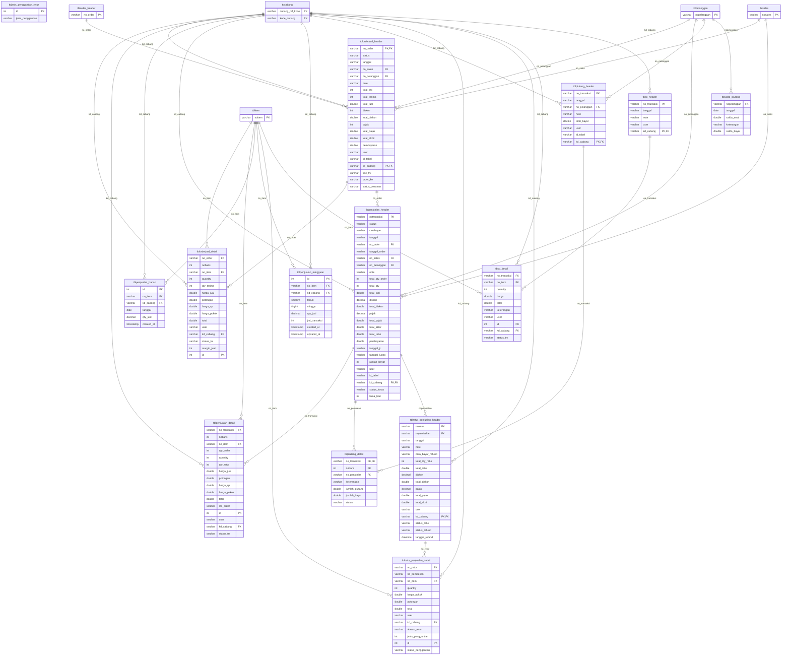

_Entitas eksternal (PK saja): `tbcabang` (D01), `tblitem` (D02), `tblorder_header` (D06), `tblpelanggan` (D03), `tblsales` (D03)_

---

## D08 — Antar Cabang

3 tabel.

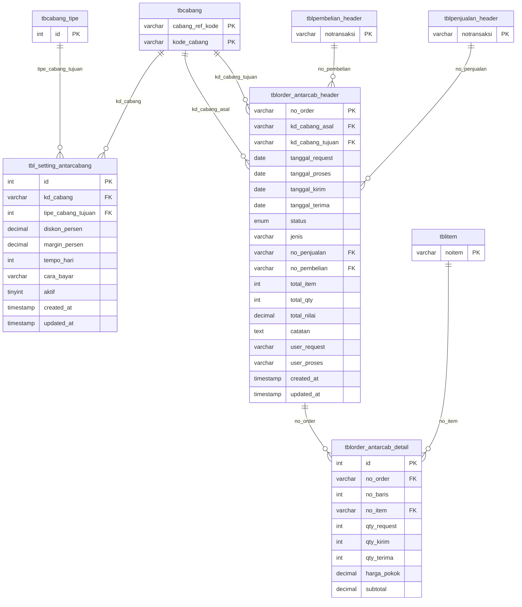

_Entitas eksternal (PK saja): `tbcabang` (D01), `tbcabang_tipe` (D01), `tblitem` (D02), `tblpembelian_header` (D06), `tblpenjualan_header` (D07)_

---

## D09 — Stok & Inventory

15 tabel.

```mermaid
erDiagram
    tbbrg_keluar_detail {
        varchar no_transaksi FK
        varchar no_item FK
        int quantity
        double harga
        double total
        varchar keterangan
        varchar user
        int id PK
        varchar kd_cabang FK
        varchar status_trx
        int stok_sistem
        int penyesuaian
    }
    tbbrg_keluar_header {
        varchar no_transaksi PK
        varchar tanggal
        varchar note
        varchar user
        varchar kd_cabang PK,FK
        varchar kd_cabang_ke FK
    }
    tbbrg_masuk_detail {
        varchar no_transaksi FK
        varchar no_item FK
        int quantity
        double harga
        double total
        varchar keterangan
        varchar user
        int id PK
        varchar kd_cabang FK
        varchar status_trx
        int stok_sistem
        int penyesuaian
    }
    tbbrg_masuk_header {
        varchar no_transaksi PK
        varchar tanggal
        varchar note
        varchar user
        varchar kd_cabang PK,FK
        varchar kd_cabang_dr FK
    }
    tbitem_keluar_detail {
        varchar no_transaksi FK
        varchar no_item FK
        int quantity
        double harga
        double total
        varchar keterangan
        varchar user
        int id PK
        varchar kd_cabang FK
        varchar status_trx
        int stok_sistem
        int penyesuaian
    }
    tbitem_keluar_header {
        varchar no_transaksi PK
        varchar tanggal
        varchar note
        varchar user
        varchar kd_cabang PK,FK
    }
    tbitem_masuk_detail {
        varchar no_transaksi FK
        varchar no_item FK
        int quantity
        double harga
        double total
        varchar keterangan
        varchar user
        int id PK
        varchar kd_cabang FK
        varchar status_trx
        int stok_sistem
        int penyesuaian
    }
    tbitem_masuk_header {
        varchar no_transaksi PK
        varchar tanggal
        varchar note
        varchar user
        varchar kd_cabang PK,FK
    }
    tbkoreksi_stok_detail {
        varchar no_transaksi FK
        varchar no_item FK
        int quantity
        varchar keterangan
        varchar user
        int id PK
        varchar kd_cabang FK
        varchar status_trx
        int stok_sistem
        int penyesuaian
        int tipe_stok
    }
    tbkoreksi_stok_header {
        varchar no_transaksi PK
        varchar tanggal
        varchar note
        varchar user
        varchar kd_cabang PK,FK
    }
    tblitem_koreksi_detail {
        varchar no_transaksi PK,FK
        varchar kd_cabang PK,FK
        int no_baris PK
        varchar no_item FK
        varchar type_tr
        decimal qty
        decimal harga
        decimal hpp
        decimal total
        text note
        timestamp synced_at
    }
    tblitem_koreksi_header {
        varchar no_transaksi PK
        varchar kd_cabang PK,FK
        date tanggal
        decimal total_qty
        decimal total
        text note
        varchar user_input
        varchar id_tabel
        timestamp synced_at
    }
    tblitem_mutasi_detail {
        varchar no_transaksi PK,FK
        varchar kd_cabang PK,FK
        int no_baris PK
        varchar no_item FK
        varchar type_tr
        decimal qty
        decimal harga
        decimal total
        text note
        timestamp synced_at
    }
    tblitem_mutasi_header {
        varchar no_transaksi PK
        varchar kd_cabang PK,FK
        date tanggal
        decimal total_qty
        decimal total
        text note
        varchar user_input
        varchar id_tabel
        timestamp synced_at
    }
    tbstok {
        varchar tipe
        varchar no_transaksi
        varchar no_item FK
        date tanggal
        int masuk
        int keluar
        varchar keterangan
        varchar kd_cabang FK
        int id PK
    }
    tbcabang {
        varchar cabang_ref_kode PK
        varchar kode_cabang PK
    }
    tblitem {
        varchar noitem PK
    }
    tbcabang ||--o{ tbbrg_keluar_detail : "kd_cabang"
    tblitem ||--o{ tbbrg_keluar_detail : "no_item"
    tbbrg_keluar_header ||--o{ tbbrg_keluar_detail : "no_transaksi"
    tbcabang ||--o{ tbbrg_keluar_header : "kd_cabang"
    tbcabang ||--o{ tbbrg_keluar_header : "kd_cabang_ke"
    tbcabang ||--o{ tbbrg_masuk_detail : "kd_cabang"
    tblitem ||--o{ tbbrg_masuk_detail : "no_item"
    tbbrg_masuk_header ||--o{ tbbrg_masuk_detail : "no_transaksi"
    tbcabang ||--o{ tbbrg_masuk_header : "kd_cabang"
    tbcabang ||--o{ tbbrg_masuk_header : "kd_cabang_dr"
    tbcabang ||--o{ tbitem_keluar_detail : "kd_cabang"
    tblitem ||--o{ tbitem_keluar_detail : "no_item"
    tbitem_keluar_header ||--o{ tbitem_keluar_detail : "no_transaksi"
    tbcabang ||--o{ tbitem_keluar_header : "kd_cabang"
    tbcabang ||--o{ tbitem_masuk_detail : "kd_cabang"
    tblitem ||--o{ tbitem_masuk_detail : "no_item"
    tbitem_masuk_header ||--o{ tbitem_masuk_detail : "no_transaksi"
    tbcabang ||--o{ tbitem_masuk_header : "kd_cabang"
    tbcabang ||--o{ tbkoreksi_stok_detail : "kd_cabang"
    tblitem ||--o{ tbkoreksi_stok_detail : "no_item"
    tbkoreksi_stok_header ||--o{ tbkoreksi_stok_detail : "no_transaksi"
    tbcabang ||--o{ tbkoreksi_stok_header : "kd_cabang"
    tbcabang ||--o{ tblitem_koreksi_detail : "kd_cabang"
    tblitem ||--o{ tblitem_koreksi_detail : "no_item"
    tblitem_koreksi_header ||--o{ tblitem_koreksi_detail : "no_transaksi"
    tbcabang ||--o{ tblitem_koreksi_header : "kd_cabang"
    tbcabang ||--o{ tblitem_mutasi_detail : "kd_cabang"
    tblitem ||--o{ tblitem_mutasi_detail : "no_item"
    tblitem_mutasi_header ||--o{ tblitem_mutasi_detail : "no_transaksi"
    tbcabang ||--o{ tblitem_mutasi_header : "kd_cabang"
    tbcabang ||--o{ tbstok : "kd_cabang"
    tblitem ||--o{ tbstok : "no_item"
```

_Entitas eksternal (PK saja): `tbcabang` (D01), `tblitem` (D02)_

---

## D10 — Keuangan Kasir & Setoran

33 tabel.

```mermaid
erDiagram
    audit_log_closing_kasir {
        int id PK
        varchar kode_karyawan FK
        enum action
        varchar table_name
        varchar record_id
        text old_data
        text new_data
        timestamp created_at
    }
    closing_revision_requests_closing_kasir {
        int id PK
        varchar kode_transaksi_lama
        varchar kode_transaksi_baru
        varchar kode_cabang FK
        varchar kode_pemohon FK
        text alasan
        enum status
        varchar approver_kode
        text approval_note
        datetime approved_at
        datetime rejected_at
        timestamp created_at
    }
    closing_transaction_details_closing_kasir {
        int id PK
        int group_id FK
        int transaction_id FK
        enum jenis_dalam_closing
        decimal nominal
        text keterangan
        timestamp created_at
    }
    closing_transaction_groups_closing_kasir {
        int id PK
        varchar group_code
        varchar nama_cabang
        varchar kode_setoran
        date tanggal_closing
        decimal total_closing
        decimal total_dipinjam
        decimal total_meminjam
        decimal total_gabungan
        int jumlah_transaksi
        enum status_validasi
        varchar validated_by
        timestamp validated_at
        text catatan_validasi
        timestamp created_at
        timestamp updated_at
    }
    data_penjualan_closing_kasir {
        int id PK
        varchar kode_transaksi FK
        decimal jumlah_penjualan
        date tanggal
        time waktu
        varchar kode_karyawan FK
    }
    data_servis_closing_kasir {
        int id PK
        varchar kode_transaksi FK
        decimal jumlah_servis
        date tanggal
        time waktu
        varchar kode_karyawan FK
    }
    detail_kas_akhir {
        int id PK
        varchar kode_transaksi FK
        int nominal
        int jumlah_keping
    }
    detail_kas_awal {
        int id PK
        varchar kode_transaksi FK
        int nominal
        int jumlah_keping
    }
    kas_akhir {
        int id PK
        varchar kode_transaksi FK
        decimal total_nilai
        date tanggal
        time waktu
        varchar kode_karyawan FK
    }
    kas_awal {
        int id PK
        varchar kode_transaksi FK
        decimal total_nilai
        date tanggal
        time waktu
        enum status
        varchar kode_karyawan FK
    }
    kas_awal_config_closing_kasir {
        int id PK
        varchar kode_cabang FK
        varchar nama_cabang
        decimal nominal_minimum
        enum status
        varchar created_by
        varchar updated_by
        timestamp created_at
        timestamp updated_at
    }
    kasir_transactions_closing_kasir {
        int id PK
        varchar kode_transaksi
        decimal kas_awal
        decimal kas_akhir
        decimal total_pemasukan
        decimal total_pengeluaran
        decimal total_penjualan
        decimal total_servis
        enum status
        date tanggal_transaksi
        date tanggal_closing
        time jam_closing
        decimal setoran_real
        decimal omset
        decimal data_setoran
        decimal selisih_setoran
        varchar kode_karyawan FK
        varchar kasir_asal FK
        varchar kode_cabang FK
        varchar nama_cabang
        enum deposit_status
        enum deposit_difference_status
        enum jenis_closing
        int closing_group_id FK
        tinyint is_part_of_closing
        int jenis_setoran_id
        varchar kode_setoran
        decimal jumlah_diterima_fisik
        decimal selisih_fisik
        text catatan_validasi
        int rekening_tujuan_id FK
        timestamp validasi_at
        varchar validasi_by
        varchar bukti_transaksi
        varchar revision_parent_kode
        varchar revision_child_kode
        datetime cancelled_at
        varchar cancelled_by
        text cancel_reason
    }
    keping_closing_kasir {
        int id PK
        int nominal
    }
    konfirmasi_buka_transaksi_closing_kasir {
        int id PK
        varchar kode_transaksi FK
        varchar kode_karyawan_peminta FK
        varchar nama_cabang
        datetime tanggal_permintaan
        datetime tanggal_diproses
        enum status
        text alasan_permintaan
        text catatan_admin
        varchar kode_karyawan_admin FK
        timestamp created_at
        timestamp updated_at
    }
    master_akun_closing_kasir {
        int id PK
        varchar kode_akun
        varchar arti
        enum jenis_akun
        enum kategori
        tinyint require_umur_pakai
        int min_umur_pakai
    }
    master_nama_transaksi_closing_kasir {
        int id PK
        varchar nama_transaksi
        varchar kode_akun FK
        varchar keterangan_default
        enum status
        timestamp created_at
        timestamp updated_at
    }
    master_rekening_cabang_closing_kasir {
        int id PK
        varchar kode_cabang FK
        varchar nama_bank
        varchar nama_rekening
        varchar no_rekening
        enum jenis_rekening
        enum status
        varchar created_by
        varchar updated_by
        timestamp created_at
        timestamp updated_at
    }
    pemasukan_kasir_closing_kasir {
        int id PK
        varchar kode_transaksi FK
        varchar kode_akun FK
        varchar kode_pengambilan_ref
        decimal jumlah
        varchar keterangan_transaksi
        date tanggal
        time waktu
        varchar kode_karyawan FK
        varchar kode_cabang FK
        varchar nomor_transaksi_closing
    }
    pemasukan_pusat_closing_kasir {
        int id PK
        varchar kode_transaksi
        varchar kode_karyawan FK
        varchar cabang
        varchar kode_akun FK
        decimal jumlah
        varchar keterangan
        date tanggal
        date tanggal_transaksi
        time waktu
        timestamp created_at
        timestamp updated_at
    }
    pengambilan_setoran_closing_kasir {
        int id PK
        varchar kode_pengambilan
        varchar parent_kode_pengambilan
        varchar kode_karyawan_input FK
        varchar kode_cabang_keuangan FK
        varchar nama_cabang_keuangan
        decimal nominal_diambil
        decimal nominal_sisa
        int id_setoran_bank
        varchar kode_setoran_bank
        enum jenis_rekening
        enum klasifikasi
        varchar no_rekening_peminjam
        varchar no_rekening_penerima
        varchar kode_cabang_penerima FK
        date tanggal_perencanaan_setor
        enum status
        enum status_setor_bank
        date tanggal_penyerahan_setor
        date tanggal_riil_setor_bank
        int setoran_ke_bank_id FK
        tinyint verified_nominal_kas_masuk
        tinyint verified_notrx_kas_masuk
        tinyint verified_cabang_penerima_sudah_closing
        datetime verified_cabang_closing_at
        tinyint verified_mutasi_bank
        varchar mutasi_dokumen_path
        varchar mutasi_dokumen_nama_asli
        varchar mutasi_dokumen_mime
        varchar mutasi_dokumen_tipe
        varchar mutasi_rekening_pengirim
        varchar mutasi_rekening_penerima
        decimal mutasi_nominal_terdeteksi
        enum mutasi_confidence
        longtext mutasi_hasil_json
        varchar mutasi_verified_by
        datetime mutasi_verified_at
        int id_pemasukan_gudang
        varchar keterangan
        datetime created_at
        datetime updated_at
    }
    pengambilan_setoran_edit_log_closing_kasir {
        int id PK
        varchar kode_pengambilan FK
        enum edited_by_role
        varchar edited_by_kode_karyawan
        varchar field_changed
        varchar old_value
        varchar new_value
        int pemasukan_kasir_id_invalidated
        varchar alasan
        tinyint dibaca
        datetime created_at
    }
    pengambilan_setoran_pembayaran_closing_kasir {
        int id PK
        varchar kode_pengambilan FK
        int pemasukan_kasir_id FK
        decimal nominal_dibayar
        enum sumber
        varchar no_transaksi
        date tanggal_transfer
        varchar kode_validasi_input
        varchar kode_karyawan_input FK
        varchar catatan
        varchar dokumen_path
        varchar dokumen_nama_asli
        varchar dokumen_mime
        varchar dokumen_tipe
        varchar rekening_pengirim_terdeteksi
        varchar rekening_penerima_terdeteksi
        decimal nominal_terdeteksi
        enum confidence
        longtext hasil_ekstraksi_json
        datetime created_at
    }
    pengeluaran_kasir_closing_kasir {
        int id PK
        varchar kode_transaksi FK
        varchar kode_akun FK
        decimal jumlah
        varchar keterangan_transaksi
        date tanggal
        time waktu
        varchar kode_karyawan FK
        varchar kode_cabang FK
        int umur_pakai
        varchar kategori
    }
    pengeluaran_pusat_closing_kasir {
        int id PK
        varchar kode_transaksi
        varchar kode_karyawan FK
        varchar cabang
        varchar kode_akun
        decimal jumlah
        text keterangan
        int umur_pakai
        varchar kategori
        date tanggal
        date tanggal_transaksi
        time waktu
        timestamp created_at
        timestamp updated_at
    }
    serah_terima_kasir_closing_kasir {
        int id PK
        varchar kode_serah_terima
        varchar kode_karyawan_pemberi FK
        varchar kode_karyawan_penerima FK
        varchar kode_cabang FK
        varchar kode_transaksi_asal
        datetime tanggal_serah_terima
        decimal total_setoran
        text catatan
        enum status
        timestamp created_at
        timestamp updated_at
    }
    setoran_ke_bank_closing_kasir {
        int id PK
        varchar kode_setoran
        date tanggal_setoran
        enum metode_setoran
        varchar rekening_tujuan
        decimal total_setoran
        varchar bukti_transfer
        timestamp created_at
        varchar created_by
        date tanggal_setor
    }
    setoran_ke_bank_detail_closing_kasir {
        int id PK
        int setoran_ke_bank_id FK
        int setoran_keuangan_id FK
    }
    setoran_keuangan_closing_kasir {
        int id PK
        varchar kode_setoran FK
        varchar kode_karyawan FK
        varchar kode_cabang FK
        varchar nama_cabang
        date tanggal_setoran
        date tanggal_closing
        decimal jumlah_setoran
        varchar nama_pengantar
        enum status
        timestamp created_at
        timestamp updated_at
        varchar updated_by
        varchar kasir_asal_kode FK
        varchar kasir_asal_nama
        decimal jumlah_diterima
        decimal selisih_setoran
        text catatan_validasi
        decimal total_selisih
        varchar created_by
        tinyint has_closing_transactions
        int total_closing_groups
        longtext closing_summary
    }
    tbakun {
        int no_akun
        varchar nama_akun
        varchar pos
        int debet
        int kredit
        int status_akun
        varchar akun_induk
        int no_akun_induk
    }
    tbakun_pos {
        varchar pos
    }
    tbkeping {
        double keping
        int id PK
    }
    tblakunkas {
        varchar kodeakun
        varchar namaakun
        int id PK
    }
    tblkas_keluar_masuk {
        varchar kode_km
        varchar no_bukti
        varchar kode_akun
        date tanggal
        varchar uraian
        double masuk
        double keluar
        varchar jenis
        varchar kd_cabang FK
        varchar user
        varchar kode_akun_biaya
        varchar tipe
    }
    tbcabang {
        varchar cabang_ref_kode PK
        varchar kode_cabang PK
    }
    tbuser {
        int id PK
        varchar kode_karyawan PK
    }
    tbuser ||--o{ audit_log_closing_kasir : "kode_karyawan"
    tbcabang ||--o{ closing_revision_requests_closing_kasir : "kode_cabang"
    tbuser ||--o{ closing_revision_requests_closing_kasir : "kode_pemohon"
    closing_transaction_groups_closing_kasir ||--o{ closing_transaction_details_closing_kasir : "group_id"
    kasir_transactions_closing_kasir ||--o{ closing_transaction_details_closing_kasir : "transaction_id"
    tbuser ||--o{ data_penjualan_closing_kasir : "kode_karyawan"
    kasir_transactions_closing_kasir ||--o{ data_penjualan_closing_kasir : "kode_transaksi"
    tbuser ||--o{ data_servis_closing_kasir : "kode_karyawan"
    kasir_transactions_closing_kasir ||--o{ data_servis_closing_kasir : "kode_transaksi"
    kasir_transactions_closing_kasir ||--o{ detail_kas_akhir : "kode_transaksi"
    kasir_transactions_closing_kasir ||--o{ detail_kas_awal : "kode_transaksi"
    tbuser ||--o{ kas_akhir : "kode_karyawan"
    kasir_transactions_closing_kasir ||--o{ kas_akhir : "kode_transaksi"
    tbuser ||--o{ kas_awal : "kode_karyawan"
    kasir_transactions_closing_kasir ||--o{ kas_awal : "kode_transaksi"
    tbcabang ||--o{ kas_awal_config_closing_kasir : "kode_cabang"
    closing_transaction_groups_closing_kasir ||--o{ kasir_transactions_closing_kasir : "closing_group_id"
    tbuser ||--o{ kasir_transactions_closing_kasir : "kasir_asal"
    tbcabang ||--o{ kasir_transactions_closing_kasir : "kode_cabang"
    tbuser ||--o{ kasir_transactions_closing_kasir : "kode_karyawan"
    master_rekening_cabang_closing_kasir ||--o{ kasir_transactions_closing_kasir : "rekening_tujuan_id"
    tbuser ||--o{ konfirmasi_buka_transaksi_closing_kasir : "kode_karyawan_admin"
    tbuser ||--o{ konfirmasi_buka_transaksi_closing_kasir : "kode_karyawan_peminta"
    kasir_transactions_closing_kasir ||--o{ konfirmasi_buka_transaksi_closing_kasir : "kode_transaksi"
    master_akun_closing_kasir ||--o{ master_nama_transaksi_closing_kasir : "kode_akun"
    tbcabang ||--o{ master_rekening_cabang_closing_kasir : "kode_cabang"
    master_akun_closing_kasir ||--o{ pemasukan_kasir_closing_kasir : "kode_akun"
    tbcabang ||--o{ pemasukan_kasir_closing_kasir : "kode_cabang"
    tbuser ||--o{ pemasukan_kasir_closing_kasir : "kode_karyawan"
    kasir_transactions_closing_kasir ||--o{ pemasukan_kasir_closing_kasir : "kode_transaksi"
    master_akun_closing_kasir ||--o{ pemasukan_pusat_closing_kasir : "kode_akun"
    tbuser ||--o{ pemasukan_pusat_closing_kasir : "kode_karyawan"
    tbcabang ||--o{ pengambilan_setoran_closing_kasir : "kode_cabang_keuangan"
    tbcabang ||--o{ pengambilan_setoran_closing_kasir : "kode_cabang_penerima"
    tbuser ||--o{ pengambilan_setoran_closing_kasir : "kode_karyawan_input"
    setoran_ke_bank_closing_kasir ||--o{ pengambilan_setoran_closing_kasir : "setoran_ke_bank_id"
    pengambilan_setoran_closing_kasir ||--o{ pengambilan_setoran_edit_log_closing_kasir : "kode_pengambilan"
    tbuser ||--o{ pengambilan_setoran_pembayaran_closing_kasir : "kode_karyawan_input"
    pengambilan_setoran_closing_kasir ||--o{ pengambilan_setoran_pembayaran_closing_kasir : "kode_pengambilan"
    pemasukan_kasir_closing_kasir ||--o{ pengambilan_setoran_pembayaran_closing_kasir : "pemasukan_kasir_id"
    master_akun_closing_kasir ||--o{ pengeluaran_kasir_closing_kasir : "kode_akun"
    tbcabang ||--o{ pengeluaran_kasir_closing_kasir : "kode_cabang"
    tbuser ||--o{ pengeluaran_kasir_closing_kasir : "kode_karyawan"
    kasir_transactions_closing_kasir ||--o{ pengeluaran_kasir_closing_kasir : "kode_transaksi"
    tbuser ||--o{ pengeluaran_pusat_closing_kasir : "kode_karyawan"
    tbcabang ||--o{ serah_terima_kasir_closing_kasir : "kode_cabang"
    tbuser ||--o{ serah_terima_kasir_closing_kasir : "kode_karyawan_pemberi"
    tbuser ||--o{ serah_terima_kasir_closing_kasir : "kode_karyawan_penerima"
    setoran_ke_bank_closing_kasir ||--o{ setoran_ke_bank_detail_closing_kasir : "setoran_ke_bank_id"
    setoran_keuangan_closing_kasir ||--o{ setoran_ke_bank_detail_closing_kasir : "setoran_keuangan_id"
    tbuser ||--o{ setoran_keuangan_closing_kasir : "kasir_asal_kode"
    tbcabang ||--o{ setoran_keuangan_closing_kasir : "kode_cabang"
    tbuser ||--o{ setoran_keuangan_closing_kasir : "kode_karyawan"
    kasir_transactions_closing_kasir ||--o{ setoran_keuangan_closing_kasir : "kode_setoran"
    tbcabang ||--o{ tblkas_keluar_masuk : "kd_cabang"
```

_Entitas eksternal (PK saja): `tbcabang` (D01), `tbuser` (D01)_

---

## D11 — Komplain, Issue & Merge Data

7 tabel.

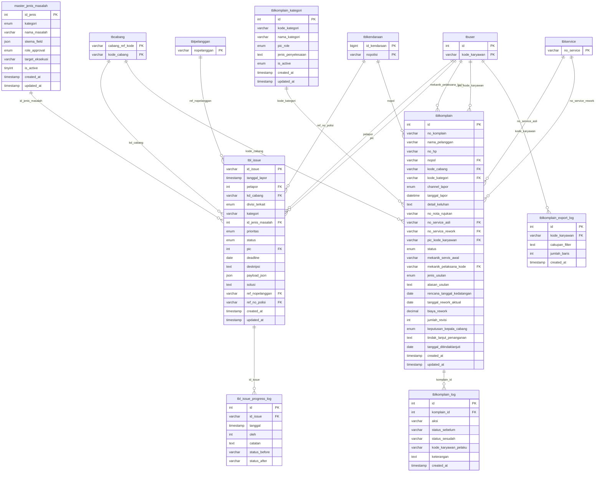

_Entitas eksternal (PK saja): `tbcabang` (D01), `tblkendaraan` (D03), `tblpelanggan` (D03), `tblservice` (D04), `tbuser` (D01)_

---

## D12 — HRD & Absensi

22 tabel.

```mermaid
erDiagram
    tbabsensi {
        varchar nip FK
        date tgl
        varchar jam_masuk
        varchar jam_keluar
        int kode_status_kehadiran
        varchar keterangan
        varchar kode_perusahaan
        varchar kode_lokasi
        varchar lat_masuk
        varchar long_masuk
        int jarak_masuk
        varchar lat_pulang
        varchar long_pulang
        int jarak_pulang
        varchar nip_di_finger
        int id PK
        varchar id_upload
    }
    tbabsensi_temp {
        int no_urut
        int id
        datetime waktu
        date tgl
        varchar jam
    }
    tbabsensi_temp_rst {
        int id
        date tgl
        varchar jam_masuk
        varchar Jam_pulang
    }
    tbabsensi_upload {
        varchar id_upload
        date tgl_upload
        varchar waktu_upload
        date tgl_absensi_awal
        date tgl_absensi_akhir
        varchar kode_cabang FK
        int id PK
    }
    tbagama {
        varchar agama
        int kode PK
    }
    tbdarah {
        int kode
        varchar darah
    }
    tbemp_education {
        int id PK
        varchar nip FK
        varchar fld1
        varchar fld2
        varchar fld3
        varchar fld4
        varchar fld5
    }
    tbemp_family {
        int id PK
        varchar nip FK
        varchar nama
        int id_jk
        varchar alamat
        varchar notlp
        varchar hubungan
    }
    tbemp_training {
        int id PK
        varchar nip FK
        varchar fld1
        varchar fld2
        int fld3
    }
    tbemp_tunjangan {
        int id PK
        varchar nip FK
        varchar nama_tunjangan
        double nilai_tunjangan
    }
    tbhari_kerja {
        int id PK
        varchar hari_kerja
    }
    tbhistory_divisi {
        varchar nip FK
        varchar kode_divisi FK
        varchar kode_jabatan FK
        date tgl_start
        date tgl_end
        int id PK
    }
    tbjk {
        int kode_jk PK
        varchar jk
    }
    tblist_bpjs {
        int id PK
        varchar list_bpjs
    }
    tbpegawai {
        varchar nip PK
        varchar nama
        varchar alamat
        varchar kode_jabatan FK
        varchar notlp
        int kode_jk
        varchar tempat_lahir
        date tgl_lahir
        varchar email
        int kode_pendidikan
        varchar npwp
        int kode_status_kawin
        int jml_tanggungan
        int kode_ptkp
        double gaji_pokok
        varchar no_rek
        varchar nama_rek
        varchar bank
        varchar ktp
        int kode_agama
        int kode_darah
        varchar no_bpjs_tk
        varchar no_bpjs_kes
        varchar kode_divisi FK
        int kode_status_emp
        date tgl_masuk
        varchar foto_pegawai
        varchar kota
        varchar prop
        varchar district
        varchar districtsub
        varchar kodepos
        int id_hari_kerja
        int jumlah_cuti
        varchar user_name
        varchar password
        date tgl_input
        varchar status_aktif
        varchar tlp_rumah
        int wage_template
        int id_tipepajak
        varchar lokasi
        varchar kode_perusahaan FK
        varchar negara
    }
    tbpegawai_salary {
        varchar nip FK
        varchar id_salary
        double jumlah
        int id PK
    }
    tbpendidikan {
        int kode PK
        varchar pendidikan
    }
    tbstatus_emp {
        int kode PK
        varchar status
    }
    tbstatus_kehadiran {
        int id PK
        varchar status_kehadiran
    }
    tbstatus_nikah {
        int kode PK
        varchar status_nikah
    }
    tbtarif_ptkp {
        varchar golongan
        varchar kode
        double tarif
        int id PK
        int id_parent
    }
    tbtarif_ptkph {
        int id PK
        varchar nama
        varchar keterangan
        date berlaku_mulai
    }
    tbcabang {
        varchar cabang_ref_kode PK
        varchar kode_cabang PK
    }
    tbdivisi {
        varchar kode_divisi PK
    }
    tbjabatan {
        varchar kode_jabatan PK
    }
    tbperusahaan {
        varchar kode_perusahaan PK
    }
    tbpegawai ||--o{ tbabsensi : "nip"
    tbcabang ||--o{ tbabsensi_upload : "kode_cabang"
    tbpegawai ||--o{ tbemp_education : "nip"
    tbpegawai ||--o{ tbemp_family : "nip"
    tbpegawai ||--o{ tbemp_training : "nip"
    tbpegawai ||--o{ tbemp_tunjangan : "nip"
    tbdivisi ||--o{ tbhistory_divisi : "kode_divisi"
    tbjabatan ||--o{ tbhistory_divisi : "kode_jabatan"
    tbpegawai ||--o{ tbhistory_divisi : "nip"
    tbdivisi ||--o{ tbpegawai : "kode_divisi"
    tbjabatan ||--o{ tbpegawai : "kode_jabatan"
    tbperusahaan ||--o{ tbpegawai : "kode_perusahaan"
    tbpegawai ||--o{ tbpegawai_salary : "nip"
```

_Entitas eksternal (PK saja): `tbcabang` (D01), `tbdivisi` (D01), `tbjabatan` (D01), `tbperusahaan` (D01)_

---

## D13 — Integrasi & Konsolidasi Access

33 tabel.

```mermaid
erDiagram
    gabung_hpp_acuan {
        varchar tahun PK
        varchar siklus PK
        varchar no_item PK
        int frek
        decimal qty
        decimal beli
        decimal acuan_hpp
        varchar sts
        timestamp synced_at
    }
    gabung_nopolisi_domisili {
        varchar no_polisi PK
        tinyint sts_pes
        tinyint sts_pac
        tinyint sts_cik
        tinyint sts_tra
        date akhir
        varchar sts
        varchar domisili
        date tanggal_data
        timestamp synced_at
    }
    gabung_pernah_jemputantar {
        varchar no_polisi PK
        int jumlah
        date tanggal_data
        timestamp synced_at
    }
    gabung_rekap_kedatangan {
        varchar no_polisi PK
        int jumlah
        date awal
        date akhir
        decimal pelanggan_sejak_hari
        decimal pelanggan_sejak_bulan
        decimal lama_tdk_dtg_hari
        decimal lama_tdk_dtg_bulan
        decimal total
        decimal rata2
        date ganti_oli_akhir
        date servis_akhir
        date datang_berikutnya
        date remind_sebelumnya
        date tanggal_data
        timestamp synced_at
    }
    gabung_rekap_konsumen {
        varchar no_polisi PK
        int jumlah
        date awal
        date akhir
        decimal pelanggan_sejak_hari
        decimal pelanggan_sejak_bulan
        decimal lama_tdk_dtg_hari
        decimal lama_tdk_dtg_bulan
        decimal total
        decimal rata2
        date tanggal_data
        timestamp synced_at
    }
    gabung_rekap_konsumen_wa {
        varchar nama_pelanggan
        varchar domisili
        int jum_motor
        decimal tot_datang
        decimal total_nilai
        decimal rata2_nilai
        date awal
        date akhir
        date datang_berikutnya
        decimal lama_pelanggan
        decimal lama_tdk_datang
        date tiap_30hari
        varchar telephone
        date tanggal_data
        timestamp synced_at
    }
    gabung_rekap_peritem_terakhir {
        varchar no_item PK
        varchar sts PK
        date tggl
        date tanggal_data
        timestamp synced_at
    }
    gabung_rekonsil_antarcabang {
        int id PK
        varchar cabang
        date tanggal
        varchar kode_jual
        varchar nama_jual
        varchar tipe_jual
        varchar kategori_jual
        varchar no_jual
        varchar item_jual
        decimal qty_jual
        decimal hpp_jual
        decimal nilai_jual
        varchar sumber
        varchar kode_beli
        varchar nama_beli
        varchar tipe_beli
        varchar kategori_beli
        varchar no_beli
        varchar item_beli
        decimal qty_beli
        decimal hpp_beli
        decimal nilai_beli
        varchar id_beli
        date tanggal_data
        timestamp synced_at
    }
    gabung_statistik_item_minggu {
        varchar noitem PK
        varchar sts PK
        decimal m1
        decimal m2
        decimal m3
        decimal m4
        decimal m5
        decimal m6
        decimal m7
        decimal m8
        decimal m9
        decimal m10
        decimal m11
        decimal m12
        timestamp synced_at
    }
    konsolidasi_pembelian_detail {
        bigint id PK
        varchar kd_cabang
        varchar no_transaksi
        int no_baris
        varchar no_item
        decimal qty_order
        decimal quantity
        decimal qty_retur
        decimal harga_pokok
        decimal potongan
        decimal harga_sp
        decimal total
        varchar sts_order
        varchar id_inv
        bigint source_run_id
        timestamp created_at
        timestamp updated_at
    }
    konsolidasi_pembelian_header {
        bigint id PK
        varchar kd_cabang
        varchar no_transaksi
        varchar status
        varchar cara_bayar
        datetime tanggal
        varchar no_order
        datetime tanggal_order
        varchar no_supplier
        text note
        decimal total_qty_order
        decimal total_qty
        decimal total_beli
        decimal diskon
        decimal total_diskon
        decimal pajak
        decimal total_pajak
        decimal total_akhir
        decimal total_retur
        decimal pembayaran
        datetime tanggal_jt
        datetime tanggal_lunas
        decimal jumlah_bayar
        varchar user_input
        varchar id_tabel
        bigint source_run_id
        datetime source_file_date
        timestamp created_at
        timestamp updated_at
    }
    konsolidasi_penjualan_detail {
        bigint id PK
        varchar kd_cabang
        varchar no_transaksi
        int no_baris
        varchar no_item
        decimal qty_order
        decimal quantity
        decimal qty_retur
        decimal harga_jual
        decimal potongan
        decimal harga_sp
        decimal harga_pokok
        decimal total
        varchar sts_order
        bigint source_run_id
        timestamp created_at
        timestamp updated_at
    }
    konsolidasi_penjualan_header {
        bigint id PK
        varchar kd_cabang
        varchar no_transaksi
        varchar status
        varchar cara_bayar
        datetime tanggal
        varchar no_order
        datetime tanggal_order
        varchar no_sales
        varchar no_pelanggan
        text note
        decimal total_qty_order
        decimal total_qty
        decimal total_jual
        decimal diskon
        decimal total_diskon
        decimal pajak
        decimal total_pajak
        decimal total_akhir
        decimal total_retur
        decimal pembayaran
        datetime tanggal_jt
        datetime tanggal_lunas
        decimal jumlah_bayar
        varchar user_input
        varchar id_tabel
        bigint source_run_id
        datetime source_file_date
        timestamp created_at
        timestamp updated_at
    }
    konsolidasi_service {
        bigint id PK
        varchar kd_cabang
        varchar no_service
        datetime tanggal
        varchar jam
        varchar no_pelanggan
        varchar no_polisi
        varchar mekanik1
        varchar mekanik2
        varchar mekanik3
        varchar mekanik4
        decimal biayam1
        decimal biayam2
        decimal biayam3
        decimal biayam4
        decimal km_sekarang
        decimal km_berikut
        decimal total_waktu
        varchar status
        text keterangan
        decimal subtotal_jasa
        decimal subtotal_item
        decimal subtotal
        decimal diskon
        decimal total_diskon
        decimal pajak
        decimal total_pajak
        decimal total_akhir
        decimal pembayaran
        varchar user_input
        varchar id_tabel
        varchar advisor
        bigint source_run_id
        datetime source_file_date
        timestamp created_at
        timestamp updated_at
    }
    stg_access_beli_peritem {
        bigint id PK
        bigint sync_run_id
        varchar kd_cabang
        datetime tanggal_data
        varchar id_tabel
        datetime tanggal
        varchar no_item
        decimal hrgnet
        varchar no_supplier
        varchar fax
        json raw_payload
    }
    stg_access_gabung_insentif {
        bigint id PK
        bigint sync_run_id
        varchar kd_cabang
        varchar sts_source
        datetime tanggal_data
        varchar siklus
        datetime tgl
        varchar trx
        decimal garap
        varchar stts
        varchar sts
        varchar kode
        varchar mekanik
        varchar tipe
        varchar no_item
        decimal quantity
        decimal jualnet
        decimal tothpp
        decimal laba
        varchar kategori
        json raw_payload
    }
    stg_access_gabung_item {
        bigint id PK
        bigint sync_run_id
        varchar kd_cabang
        varchar sts_source
        datetime tanggal_data
        varchar no_item
        varchar kode_barcode
        varchar nama_item
        varchar jenis
        varchar satuan
        decimal harga_pokok
        decimal harga_jual
        decimal harga_jual2
        decimal harga_jual3
        decimal quantity
        decimal stok_min
        varchar status_item
        varchar supplier1
        varchar supplier2
        varchar supplier3
        varchar status_produk
        varchar rak_barang
        decimal jasa_waktu
        json raw_payload
    }
    stg_access_gabung_kendaraan_pelanggan {
        bigint id PK
        bigint sync_run_id
        varchar kd_cabang
        varchar sts_source
        datetime tanggal_data
        varchar no_polisi
        varchar nama_pelanggan
        varchar merek
        varchar tipe
        varchar jenis
        varchar warna
        varchar tahun_buat
        varchar telephone
        varchar grup
        text alamat
        text note
        varchar kategori
        varchar kota
        varchar kontak_person
        json raw_payload
    }
    stg_access_gabung_mekanik {
        bigint id PK
        bigint sync_run_id
        varchar kd_cabang
        varchar sts_source
        datetime tanggal_data
        varchar no_mekanik
        varchar nama
        text alamat
        varchar kota
        varchar provinsi
        varchar no_telepon
        text note
        varchar keahlian
        json raw_payload
    }
    stg_access_gabung_member_pelanggan {
        bigint id PK
        bigint sync_run_id
        varchar kd_cabang
        varchar sts_source
        datetime tanggal_data
        varchar no_pelanggan
        varchar tipe_member
        varchar no_polisi
        json raw_payload
    }
    stg_access_gabung_pelanggan {
        bigint id PK
        bigint sync_run_id
        varchar kd_cabang
        varchar sts_source
        datetime tanggal_data
        varchar no_pelanggan
        varchar nama_pelanggan
        text alamat
        varchar kota
        varchar propinsi
        varchar kode_post
        varchar negara
        varchar telephone
        varchar fax
        varchar kontak_person
        text note
        decimal potongan
        varchar tipe_pot
        varchar lavel_harga
        varchar kgrup
        json raw_payload
    }
    stg_access_gabung_pembelian {
        bigint id PK
        bigint sync_run_id
        varchar kd_cabang
        varchar sts_source
        datetime tanggal_data
        varchar no_transaksi
        int no_baris
        varchar status
        varchar cara_bayar
        datetime tanggal
        varchar no_order
        datetime tanggal_order
        varchar no_supplier
        text note
        decimal total_qty_order
        decimal total_qty
        decimal total_beli
        decimal diskon
        decimal total_diskon
        decimal pajak
        decimal total_pajak
        decimal total_akhir
        decimal total_retur
        decimal pembayaran
        datetime tanggal_jt
        datetime tanggal_lunas
        decimal jumlah_bayar
        varchar user_input
        varchar id_tabel
        varchar no_item
        decimal qty_order
        decimal quantity
        decimal qty_retur
        decimal harga_pokok
        decimal potongan
        decimal harga_sp
        decimal total
        varchar sts_order
        varchar id_inv
        json raw_payload
    }
    stg_access_gabung_penjualan {
        bigint id PK
        bigint sync_run_id
        varchar kd_cabang
        varchar sts_source
        datetime tanggal_data
        varchar no_transaksi
        int no_baris
        varchar status
        varchar cara_bayar
        datetime tanggal
        varchar no_order
        datetime tanggal_order
        varchar no_sales
        varchar no_pelanggan
        text note
        decimal total_qty_order
        decimal total_qty
        decimal total_jual
        decimal diskon
        decimal total_diskon
        decimal pajak
        decimal total_pajak
        decimal total_akhir
        decimal total_retur
        decimal pembayaran
        datetime tanggal_jt
        datetime tanggal_lunas
        decimal jumlah_bayar
        varchar user_input
        varchar id_tabel
        varchar no_item
        decimal qty_order
        decimal quantity
        decimal qty_retur
        decimal harga_jual
        decimal potongan
        decimal harga_sp
        decimal harga_pokok
        decimal total
        varchar sts_order
        json raw_payload
    }
    stg_access_gabung_service {
        bigint id PK
        bigint sync_run_id
        varchar kd_cabang
        varchar sts_source
        datetime tanggal_data
        varchar no_service
        datetime tanggal
        varchar jam
        varchar no_pelanggan
        varchar no_polisi
        varchar mekanik1
        varchar mekanik2
        varchar mekanik3
        varchar mekanik4
        decimal biayam1
        decimal biayam2
        decimal biayam3
        decimal biayam4
        decimal km_sekarang
        decimal km_berikut
        decimal total_waktu
        varchar status
        text keterangan
        decimal subtotal_jasa
        decimal subtotal_item
        decimal subtotal
        decimal diskon
        decimal total_diskon
        decimal pajak
        decimal total_pajak
        decimal total_akhir
        decimal pembayaran
        varchar user_input
        varchar id_tabel
        varchar advisor
        json raw_payload
    }
    stg_access_gabung_service_advisor {
        bigint id PK
        bigint sync_run_id
        varchar kd_cabang
        varchar sts_source
        datetime tanggal_data
        varchar no_service
        varchar advisor
        json raw_payload
    }
    stg_access_gabung_service_barang {
        bigint id PK
        bigint sync_run_id
        varchar kd_cabang
        varchar sts_source
        datetime tanggal_data
        varchar no_service
        datetime tanggal
        varchar no_pelanggan
        varchar no_polisi
        varchar mekanik1
        varchar mekanik2
        varchar mekanik3
        varchar mekanik4
        decimal biayam1
        decimal biayam2
        decimal biayam3
        decimal biayam4
        decimal km_sekarang
        decimal km_berikut
        decimal total_waktu
        varchar status
        text keterangan
        decimal subtotal_jasa
        decimal subtotal_item
        decimal subtotal
        decimal diskon
        decimal total_diskon
        decimal pajak
        decimal total_pajak
        decimal total_akhir
        decimal pembayaran
        varchar user_input
        varchar id_tabel
        int no_baris
        varchar no_item
        decimal quantity
        decimal qty_retur
        decimal harga
        decimal potongan
        decimal total
        json raw_payload
    }
    stg_access_gabung_service_jasa {
        bigint id PK
        bigint sync_run_id
        varchar kd_cabang
        varchar sts_source
        datetime tanggal_data
        varchar no_service
        datetime tanggal
        varchar no_pelanggan
        varchar no_polisi
        varchar mekanik1
        varchar mekanik2
        varchar mekanik3
        varchar mekanik4
        decimal biayam1
        decimal biayam2
        decimal biayam3
        decimal biayam4
        decimal km_sekarang
        decimal km_berikut
        decimal total_waktu
        varchar status
        text keterangan
        decimal subtotal_jasa
        decimal subtotal_item
        decimal subtotal
        decimal diskon
        decimal total_diskon
        decimal pajak
        decimal total_pajak
        decimal total_akhir
        decimal pembayaran
        varchar user_input
        varchar id_tabel
        int no_baris
        varchar no_item
        decimal waktu
        decimal harga
        decimal potongan
        decimal total
        json raw_payload
    }
    stg_access_gabung_supplier {
        bigint id PK
        bigint sync_run_id
        varchar kd_cabang
        varchar sts_source
        datetime tanggal_data
        varchar no_supplier
        varchar nama_supplier
        text alamat
        varchar kota
        varchar propinsi
        varchar kode_post
        varchar negara
        varchar telephone
        varchar fax
        varchar nama_bank
        varchar no_account
        varchar atas_nama
        varchar kontak_person
        varchar email
        text note
        decimal saldo_awal
        datetime per_tanggal
        decimal jml_bayar
        decimal sisa
        json raw_payload
    }
    stg_access_nomor_wa {
        bigint id PK
        bigint sync_run_id
        varchar kd_cabang
        datetime tanggal_data
        varchar nama_pelanggan
        varchar telephone
        varchar no_pelanggan
        varchar domisili
        json raw_payload
    }
    sync_access_row_errors {
        bigint id PK
        bigint sync_run_id
        varchar dataset_name
        varchar row_key
        text error_message
        json raw_payload
        datetime created_at
    }
    sync_access_runs {
        bigint id PK
        varchar source_name
        varchar dataset_key
        varchar trigger_source
        varchar source_cabang
        varchar machine_name
        varchar batch_key
        varchar request_ip
        varchar source_file
        enum sync_mode
        datetime started_at
        datetime finished_at
        datetime last_heartbeat_at
        enum status
        int total_rows
        int success_rows
        int failed_rows
        varchar merge_status
        int merge_processed
        int merge_inserted
        int merge_updated
        int merge_upserted
        text notes
    }
    sync_gabung_log {
        int id PK
        varchar dataset_key
        varchar source_table
        varchar target_table
        datetime started_at
        datetime finished_at
        enum status
        int total_rows
        int success_rows
        int failed_rows
        text notes
    }
    tbsiklus {
        varchar kd_cabang PK
        varchar siklus PK
        date tglawal
        date tglakhir
        timestamp synced_at
    }
```
